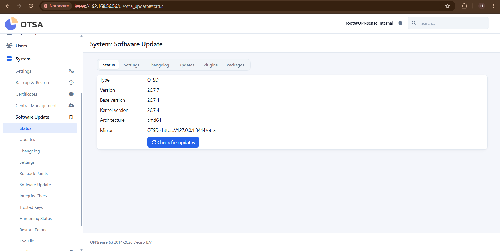
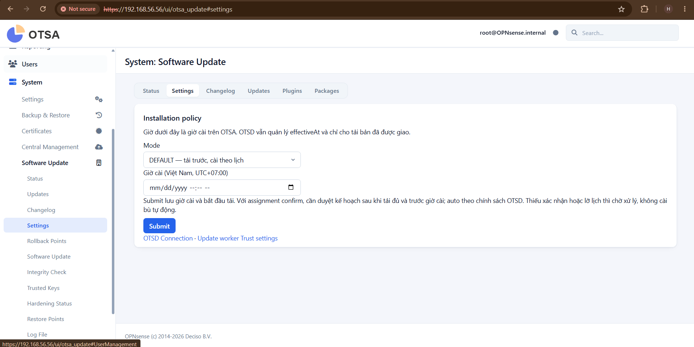
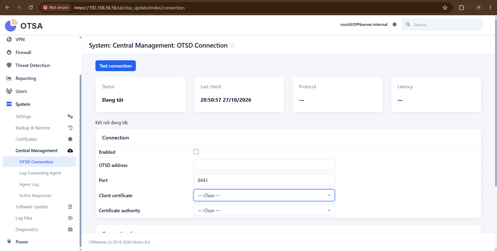
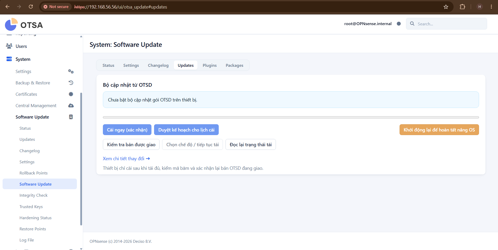

# BÁO CÁO TIẾN ĐỘ OTSA — 27/10/2026

**Người thực hiện:** Hoàng  
**Môi trường triển khai:** Lab OTSA 192.168.56.56

## 1. Tiến độ tổng thể

Đã hoàn thành phần điều chỉnh backend cho bộ nâng hệ điều hành **0.1.7** và overlay lên lab .56. Giao diện Software Update và OTSD Connection đã được chỉnh theo yêu cầu. Hiện đang chuyển sang kiểm thử tích hợp với OTSD thật; 

| Hạng mục | Kết quả hiện tại |
|---|---|
| Bộ nâng OS 0.1.7 | Đã kiểm nội dung và hash bộ thử; bộ chứa base/kernel OPNsense 26.7.7 cùng chữ ký OPNsense, không có kho gói MINT |
| Backend xử lý bộ mới | Đã hỗ trợ các trường repo, repoCurrent, signature bằng null; bỏ bước cài pkg đối với bộ upgrade chỉ có sets |
| Kiểm tra bộ tải | Giữ kiểm SHA256SUMS theo hash từ assignment và hash từng tệp; yêu cầu đầy đủ base/kernel cùng các tệp .sig trước khi sẵn sàng |
| Luồng cài OS | Đã triển khai yêu cầu quản trị xác nhận, tạo Boot Environment trước cài, suy bản OS từ tên tệp sets, dùng opnsense-update với kiểm chữ ký; không dùng tùy chọn bỏ kiểm chữ ký -i |
| Hậu kiểm nâng cấp | Đã triển khai kiểm base và kernel sau boot mới; chỉ ghi receipt thành công khi cả hai đúng bản đích |
| Kiểm thử độc lập | 146 ca staging trên FreeBSD đạt; các thao tác cài OS, tạo BE và reboot trong bộ kiểm thử được mô phỏng, chưa phải nghiệm thu nâng cấp thật |
| Overlay lab .56 | Đã cập nhật hai helper backend package_update.py và package_sets.py; có backup phục hồi, kiểm GUI/API sau overlay đạt |
| Kết nối OTSD .25 | Kiểm tra từ .56 nhận HTTP 401 và X-OTSD-Error: cert_missing, xác nhận đã tới dịch vụ OTSD |
| Enrollment/mTLS thật | Chưa hoàn tất; cần đối chiếu định danh agent hiện có với đăng ký phía OTSD trước khi xin chứng chỉ |
| Bộ 907 luật Suricata | Đã kiểm đủ 907 luật, 907 SID không trùng; chưa kiểm bằng engine Suricata hoặc nạp vào dịch vụ đang chạy |

**Giới hạn kết quả hiện tại:** HTTP 401 cert_missing chỉ chứng minh thông đường tới dịch vụ. Bài kiểm tra dùng curl -k nên chưa chứng minh CA, mTLS hoặc định danh thiết bị hợp lệ. Việc kiểm hash bộ thử cũng chưa thay thế bài kiểm chữ ký bằng công cụ OPNsense trên lab.

Theo lần kiểm sau overlay gần nhất, base và kernel của lab vẫn là **26.7.4**; các cờ thực thi cập nhật đều tắt. Chưa tạo BE, cài base/kernel hoặc reboot trong đợt kiểm thử này.

## 2. Phần giao diện đã thực hiện

- Sáu tab **Status, Settings, Changelog, Updates, Plugins, Packages** nằm trong plugin otsa-update; phần triển khai đợt này không đưa vào Core.
- **Status:** bố cục gọn theo giao diện tham chiếu, hiển thị Version type là OTSD, bỏ commit/repository; giữ nút Check for updates. Phiên bản hệ thống lấy từ backend, không sửa metadata OS để đổi hiển thị.

- **Changelog:** bổ sung bảng Version/Date và vùng nội dung thay đổi; không tạo lịch sử hoặc ngày phát hành giả khi backend chưa cung cấp dữ liệu.
- **Updates:** thay vùng log dài bằng trạng thái/tiến độ từ backend; hai nút xanh đặt bên trái hàng đầu, nút reboot màu cam bên phải, ba nút phụ ở hàng dưới. Bỏ hai nút Trusted Keys/Rollback Points khỏi panel Updates, thêm liên kết sang Changelog.
- **OTSD Connection:** bố trí nút Test connection, các ô trạng thái kết nối, bảng cấu hình, Connection log và nút Apply. Danh sách chứng chỉ/CA lấy từ System Certificates; chỉ lưu tham chiếu, không trả private key qua API. Connection log hiện phản ánh lần kiểm gần nhất, chưa phải lịch sử heartbeat đầy đủ. Apply lưu cấu hình; chức năng reload service được để lại theo thống nhất.

## 3. Tác dụng các nút trên trang nâng cấp — tab Updates

| Nút/liên kết | Tác dụng và điều kiện sử dụng |
|---|---|
| **Kiểm tra bản được giao** | Hỏi OTSD về bản đang giao cho thiết bị. Thao tác này không tự cài đặt. |
| **Chọn chế độ / tiếp tục tải** | Nếu chưa chọn chế độ, chuyển sang Settings để lựa chọn. Nếu đã chọn chế độ, thực hiện tải hoặc tiếp tục tải và kiểm tra bộ cập nhật. |
| **Cài ngay (xác nhận)** | Khi bộ đã sẵn sàng, mở kế hoạch để quản trị xem và xác nhận cài ngay. Trước khi cài, backend kiểm lại assignment/quyền cài, cache và các điều kiện an toàn. |
| **Duyệt kế hoạch cho lịch cài** | Quản trị xác nhận kế hoạch để chờ giờ cài đã đặt; không cài ngay khi bấm duyệt. Chỉ áp dụng khi bộ đã sẵn sàng và lịch còn hợp lệ. |
| **Khởi động lại để hoàn tất nâng OS** | Chỉ khả dụng khi backend xác nhận giao dịch nâng OS đang cần reboot. Mở hộp xác nhận riêng; sau xác nhận, yêu cầu khởi động lại sau một phút. |
| **Đọc lại trạng thái tải** | Đọc trạng thái hiện có trên thiết bị; không bắt đầu tải/cài và không reload service. |
| **Xem chi tiết thay đổi ➔** | Chuyển sang tab Changelog để xem nội dung thay đổi. |

Trong hộp thoại cài đặt, nút **Xác nhận** mới chấp thuận kế hoạch đã xem; nút **Hủy** đóng hộp thoại mà không xác nhận cài. Reboot có bước xác nhận riêng.

Trong tab **Settings**, nút **Submit** chốt chế độ và bắt đầu tải ngay khi OTSD đã cho phép giao bản:

- **Tải trước, cài theo lịch:** tải đủ và xác minh trước, giữ bộ hợp lệ để chờ giờ cài. Với bản yêu cầu confirm, quản trị phải duyệt kế hoạch trước giờ cài.
- **Tải đủ rồi cài ngay:** tải và xác minh toàn bộ trước khi cài; bộ upgrade vẫn bắt buộc quản trị xác nhận.
- **Nếu trễ lịch:** không tự cài bù theo lịch cũ. Giữ cache hợp lệ, hiển thị trạng thái chờ xử lý; người vận hành chọn Cài ngay có xác nhận hoặc đặt lịch mới. Trước lần cài tiếp theo vẫn phải kiểm lại assignment/quyền và tính toàn vẹn của bộ.

Các nút cài và reboot bị khóa khi chưa đủ điều kiện hoặc chưa bật quyền thực thi. Việc có giao diện không đồng nghĩa lab đã được bật cài OS.

## 4. Công việc tiếp theo

1. Xác nhận đăng ký thiết bị phía OTSD: agent thực trên lab đang có tên **OPNsense.internal**, ID **001**; tên dự kiến giao bản trước đó được trao đổi là **OTSA.internal**. Chưa tự đổi định danh trên lab.
2. Sau khi thống nhất định danh, cấu hình enrollment với CA pin do OTSD cung cấp; kiểm chứng chỉ, mTLS và kết quả /otsa/whoami. Không dùng -k cho luồng xác thực/tải thật.
3. Kiểm đọc assignment và tải đầy đủ bộ 0.1.7 từ OTSD, xác minh hash và các điều kiện sẵn sàng. Thời điểm OTSD cho phép giao bản và giờ cài do người vận hành đặt là hai mốc riêng.
4. Trình duyệt phạm vi kiểm thử nâng OS thật: tạo BE, cài base/kernel, xác nhận reboot và hậu kiểm. Kiểm phiên bản base/kernel 26.7.7, thông tin kernel theo yêu cầu Dương; kiểm nhánh chữ ký hỏng và hướng phục hồi bằng BE cũ trong phạm vi được duyệt.
5. Kiểm riêng bộ 907 luật bằng engine Suricata; việc nạp vào dịch vụ đang chạy được duyệt riêng.

