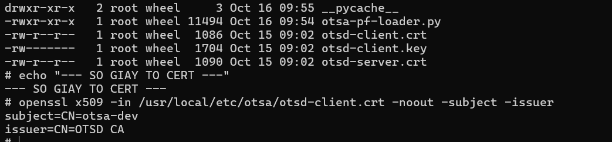
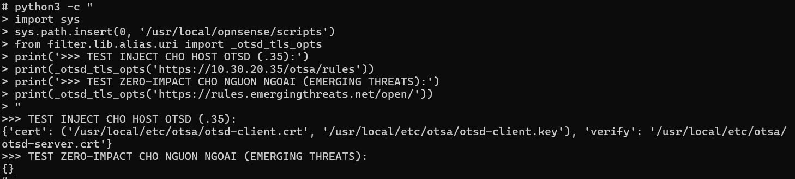
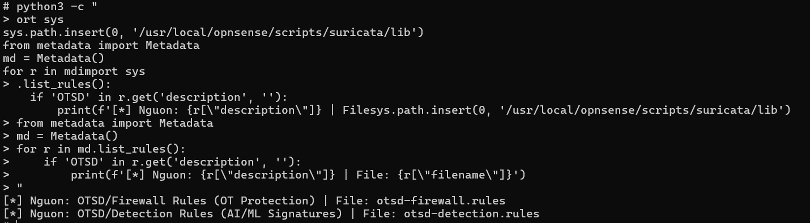
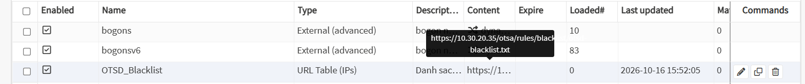

# BÁO CÁO KẾT QUẢ TRIỂN KHAI & PHỐI HỢP KỸ THUẬT OTSD ↔ OTSA
## THIẾT LẬP KÊNH TRUYỀN DỮ LIỆU AN TOÀN & ĐIỀU PHỐI BẢN PHÁT HÀNH QUA HTTPS mTLS (TASK 12)

| Thông tin | Chi tiết |
|---|---|
| **Đơn vị phối hợp** | • **Thiết bị biên (OTSA):** Hoàng (Phụ trách OPNsense Core & Agent)<br>• **Trung tâm (OTSD):** Dương (Phụ trách Máy chủ điều phối & Kho gói) |
| **Ngày cập nhật** | **Thứ Sáu, 16/10/2026** (Cập nhật hoàn tất 100% lộ trình V1 – V5) |
| **Trạng thái** | **Giai đoạn 1 & 2 hoàn thành 100%:** Xác thực mTLS thành công, kiểm tra chữ ký số bộ phát hành PASS luồng nhập OTSD, thống nhất 5 điểm kiến trúc, hoàn thiện và kiểm chứng thực tế toàn bộ lộ trình V1 – V5 trên OPNsense Core. |

---

## I. BỐI CẢNH & MỤC TIÊU PHỐI HỢP

1. **Kế thừa kết quả khảo sát Task 11:** 
   - Sau khi khảo sát thực nghiệm chứng minh cổng 1514 của Wazuh không thể dùng để truyền dữ liệu lớn (chặn 100% file AI binary, sốc socket 1.1MB làm rớt mạng 20 giây, WPK không hỗ trợ FreeBSD), thống nhất triển khai **Kiến trúc 2 kênh độc lập (Dual-Channel Architecture)**.
2. **Mục tiêu phối hợp giai đoạn này:**
   - Xây dựng kênh dữ liệu độc lập qua **HTTPS kết hợp xác thực chứng chỉ số hai chiều (mTLS)** giữa trạm biên OPNsense (OTSA) và máy chủ trung tâm (OTSD).
   - Thử nghiệm đóng gói, ký số kép ngoại tuyến và kiểm thử luồng nhập kho tự động của OTSD với 2 bộ phát hành mẫu (`otsa-0.0.1` và `otsa-0.0.2`).
   - Thống nhất các nguyên tắc điều phối bản phát hành phần mềm và bảo mật danh tính Wazuh Agent.
   - Hiện thực hóa và kiểm chứng trên mã nguồn OPNsense toàn bộ chuỗi **V1 – V5** (Lưu trữ chứng chỉ, Kẹp mTLS vào Core, Nạp luật Suricata IDS, Nạp IP Blacklist qua URL Table Alias, Nạp tập luật tường lửa nhân PF tự động qua API).

---

## II. KẾT QUẢ TRIỂN KHAI THỰC NGHIỆM CHI TIẾT

```
┌─────────────────────────────────────────────────────────────────────────────────┐
│                           MÁY CHỦ TRUNG TÂM (OTSD)                              │
│                                                                                 │
│   • Luồng nhập kho: Nhận file .tar, kiểm tra chữ ký số SHA256SUMS.sig [PASS]    │
│   • Điều phối: Chặn hạ cấp, chặn tải trước giờ hẹn (HTTP 403)                   │
│   • Cung cấp URL cố định: /otsa/package/current/repo                            │
│   • Phân phối dữ liệu: Tập luật Suricata (V3), IP Blacklist (V4), Luật PF (V5)  │
└────────────────────────────────────────┬────────────────────────────────────────┘
                                         │  Kênh HTTPS mTLS (Port 443 / 8443)
                                         │  Xác thực Client Cert (otsd-client.crt)
                                         ▼
┌─────────────────────────────────────────────────────────────────────────────────┐
│                        THIẾT BỊ BIÊN OTSA (OPNSENSE)                            │
│                                                                                 │
│   • pkg & libfetch: Tự động gửi Client Cert lấy meta.conf & packagesite [PASS]  │
│   • V1: Lưu trữ chứng chỉ mTLS bảo mật cao tại /usr/local/etc/otsa/ [PASS]      │
│   • V2: OPNsense Core (downloader.py, uri.py) tự kẹp mTLS khi gặp OTSD [PASS]   │
│   • V3: Suricata Metadata parser nhận diện luật OTSD hiển thị trên GUI [PASS]   │
│   • V4: URL Table Alias định kỳ nạp IP cấm vào bảng nhân pfctl [PASS]           │
│   • V5: Bộ nạp otsa-pf-loader.py nạp luật PF qua API, chuẩn UTF-8 [PASS]        │
└─────────────────────────────────────────────────────────────────────────────────┘
```

### 1. Thử nghiệm kết nối mTLS với chứng chỉ thiết bị trên OPNsense
* **Phương pháp triển khai:**
  - Bên OTSA lựa chọn phương án cấu hình biến môi trường kết nối mTLS trong file cấu hình kho của `pkg` (`/usr/local/etc/pkg/repos/OTSD.conf`), tận dụng cơ chế đọc biến môi trường có sẵn của thư viện nền tảng `libfetch` trên FreeBSD:
    ```text
    OTSD: {
      url: "https://<địa chỉ OTSD>/otsa/package/current/repo",
      signature_type: "fingerprints",
      fingerprints: "/usr/local/etc/pkg/fingerprints/OTSA",
      env: { 
        SSL_CLIENT_CERT_FILE: "/usr/local/etc/otsa/otsd-client.crt", 
        SSL_CLIENT_KEY_FILE: "/usr/local/etc/otsa/otsd-client.key", 
        SSL_CA_CERT_FILE: "/usr/local/etc/otsa/otsd-server.crt" 
      }
    }
    ```
* **Kết quả đo kiểm trên lab:**
  - Lệnh kiểm tra `fetch` và lệnh `pkg update -f -r OTSD` kết nối thành công tới máy chủ mTLS.
  - Phía máy chủ ghi nhận bắt tay TLS thành công và xác thực chính xác danh tính thiết bị client: `depth=0 CN=otsa-dev`.
  - Phía OPNsense tải về trọn vẹn `meta.conf` và danh mục gói `packagesite.pkg` mà không gặp lỗi phân quyền hay đứt gãy kết nối.
  - Khởi tạo thành công thư mục fingerprints tin cậy: `/usr/local/etc/pkg/fingerprints/OTSA/trusted/otsa-repo` chứa mã băm SHA-256 (`cd2fde7e000ca35bcf8dd3c719f8700879c887208089d89b6b403c61a4c86fa7`).

---

### 2. Đóng gói & Xác thực chữ ký số 2 bộ phát hành mẫu (Mục 2)
* **Quy cách đóng gói & Cơ chế ký số kép:**
  - Nhóm OTSA đã tạo 2 bộ phát hành mẫu:
    + `otsa-0.0.1.tar`: Bản phát hành cơ sở ban đầu (chứa gói `os-wazuh-agent-1.3_1`).
    + `otsa-0.0.2.tar`: Bản phát hành nâng cấp, có khai báo điều kiện phụ thuộc `min_from: "0.0.1"`.
  - Áp dụng mô hình **Chữ ký số kép ngoại tuyến (Dual-tier Offline Signing)** đảm bảo an toàn chuỗi cung ứng:
    1. *Tầng danh mục gói (`packagesite`):* Được ký bằng khóa `otsa-repo.key`, phía OPNsense dùng khóa công khai `otsa-repo.pub` thông qua thư mục `fingerprints/` để thẩm tra gói khi cài đặt.
    2. *Tầng gói phát hành (`SHA256SUMS.sig` & `manifest.json.sig`):* Được ký bằng khóa phát hành `otsa-release.key`, phía OTSD dùng khóa công khai `otsa-release.pub` để thẩm tra toàn bộ gói khi nhập kho.
* **Kết quả kiểm thử luồng nhập kho phía OTSD & Phản hồi kỹ thuật:**
  - Nhóm OTSD (Dương) đã đưa 2 bộ mẫu vào chạy luồng nhập kho tự động của hệ thống OTSD.
  - **Kết quả:** Chữ ký `SHA256SUMS.sig` và `manifest.json.sig` khớp 100% với `otsa-release.pub`. Hệ thống OTSD nhập thành công cả ở định dạng thư mục lẫn file nén `.tar`.
  - Phía OTSD đã cập nhật bộ lọc để tiếp nhận trơn tru các liên kết tượng trưng do công cụ `pkg repo` sinh ra (`packagesite.tzst` $\rightarrow$ `packagesite.pkg` và `data.tzst` $\rightarrow$ `data.pkg`).
* **Lưu ý kỹ thuật quan trọng từ OTSD cho bài toán nâng cấp thật (`pkg upgrade`):**
  - Trong 2 bộ mẫu thử nghiệm ban đầu, cả 2 bộ đều chứa cùng gói `os-wazuh-agent-1.3_1` (cùng mã băm SHA-256). Ở góc độ kho gói của FreeBSD/OPNsense, khi số phiên bản không đổi thì lệnh `pkg upgrade` sẽ xác định hệ thống đã ở bản mới nhất và không thực hiện cài đè.
  - **Khuyến nghị & Quy chuẩn đóng gói tiếp theo:** Khi đóng gói bản nâng cấp `0.0.2` để kiểm thử thực tế quy trình nâng cấp và cơ chế ZFS Boot Environment (BE Rollback), bên OTSA phải cập nhật trường `version` trong tệp `+MANIFEST` của gói phần mềm lên phiên bản cao hơn (ví dụ: `os-wazuh-agent-1.4_0`). Khi đó `pkg` mới nhận diện được sự thay đổi để tải và nâng cấp nhị phân.

---

### 3. Thống nhất 5 nguyên tắc điều phối kiến trúc bản phát hành (Mục 4)
Qua trao đổi kỹ thuật chi tiết, hai nhóm đã đạt được sự đồng thuận tuyệt đối trên 5 điểm cốt lõi:

| STT | Vấn đề kỹ thuật | Giải pháp thống nhất giữa OTSD và OTSA | Ý nghĩa vận hành mạng OT |
|:---:|---|---|---|
| **1** | **Chế độ phát hành (`auto` vs `confirm`)** | • OTSD chặn chế độ `auto` đối với bản phát hành loại `upgrade` (nâng cấp lớn, cần reboot).<br>• `auto` chỉ áp dụng cho `update` nhỏ; bản `upgrade` bắt buộc quản trị viên xác nhận.<br>• OTSA luôn chủ động tạo ZFS Boot Environment trước khi nâng cấp. | Ngăn chặn việc thiết bị tự động reboot làm gián đoạn dây chuyền công nghiệp. Luôn có đường hoàn nguyên (rollback). |
| **2** | **Phân tách Manifest đã ký & Chỉ thị điều phối** | • Các trường kỹ thuật gốc: `version`, `kind`, `abi`, `min_from` lấy từ `manifest.json` gốc đã được nhóm OTSA ký số.<br>• Các trường điều phối: `apply` và `effectiveAt` là chỉ thị động do người quản trị OTSD thiết lập trên giao diện trung tâm. | Đảm bảo tính toàn vẹn của mã nguồn phần mềm, không thể bị sửa đổi trái phép trên đường truyền. |
| **3** | **Kiểm soát thời điểm cài đặt (Chống tải sớm)** | • Trước mốc thời gian hẹn `effectiveAt`, máy chủ OTSD chủ động từ chối phục vụ bản mới (trả về mã HTTP `403 Forbidden`). | Ngăn chặn việc lệnh `pkg upgrade` chạy sớm ngoài cửa sổ bảo trì cho phép của nhà máy. |
| **4** | **Tối ưu hóa cấu hình kho (Đường dẫn cố định)** | • OTSD cung cấp đường dẫn tĩnh: `/otsa/package/current/repo` luôn trỏ tới kho của bản đang được phân công cho thiết bị.<br>• `manifest.json` trả về trường `repoCurrent` trỏ về endpoint này. | OPNsense chỉ cần cấu hình file `OTSD.conf` **1 lần duy nhất**, không phải sửa file cấu hình mỗi khi nâng phiên bản. |
| **5** | **Xử lý mất kết nối / Ngoại tuyến** | • OTSD duy trì trạng thái lệnh phát hành cho tới khi có chỉ thị mới.<br>• Khi OPNsense online trở lại, thiết bị vẫn nhận được bản phát hành.<br>• Mỗi lần OPNsense đọc file `meta.conf`, giao diện OTSD tự động cập nhật trạng thái *"SA đã thấy bản mới"*. | Đảm bảo độ tin cậy phân phối trong môi trường mạng công nghiệp thường xuyên bị cô lập hoặc mất kết nối tạm thời. |

---

### 3.1. Cơ chế đảm bảo an toàn nâng cấp với ZFS Boot Environment (BE Rollback)
Để đáp ứng chỉ thị của OTSD: *"Bản upgrade chỉ phát hành ở chế độ confirm; OTSA chủ động tạo Boot Environment trước mỗi lần nâng cấp để luôn có đường lùi an toàn"*, bên OTSA đã khảo sát và kiểm chứng thực nghiệm cơ chế khôi phục trạng thái hệ điều hành bằng công cụ `bectl` trên nền tảng ZFS của OPNsense:

* **Kết quả đo kiểm thực tế trên thiết bị OPNsense:**
  - Kiểm tra trạng thái phân vùng ban đầu:
    ```text
    # bectl list
    BE      Active Mountpoint Space Created
    default NR     /          1.72G 2026-09-11 18:21
    ```
    *(Trong đó: `N` = Now: BE đang chạy trực tiếp trên RAM; `R` = Reboot: BE sẽ được nạp khi khởi động lại).*
  - Thực hiện lệnh chụp nhanh trạng thái hệ thống trước khi nâng cấp:
    ```sh
    bectl create otsa-backup-v1
    ```
  - Kết quả kiểm chứng tức thời:
    ```text
    # bectl list
    BE             Active Mountpoint Space Created
    default        NR     /          1.72G 2026-09-11 18:21
    otsa-backup-v1 -      -          8K    2026-10-16 15:53
    ```
    *Nhận xét:* Bản sao lưu `otsa-backup-v1` được sinh ra ngay lập tức với dung lượng chỉ vỏn vẹn **`8K`** (chỉ lưu con trỏ metadata ban đầu).
* **Kịch bản hoàn nguyên sự cố (Rollback Protocol) 2 cấp độ:**
  1. *Khôi phục Trực tuyến (Online Rollback):* Nếu sau khi `pkg upgrade` phát hiện dịch vụ tường lửa/Wazuh hoạt động không đúng, quản trị viên chỉ cần kích hoạt lại bản cũ trong terminal:
     ```sh
     bectl activate otsa-backup-v1
     reboot
     ```
     Hệ thống khởi động lại và lập tức trở về trạng thái nguyên bản trước khi nâng cấp.
  2. *Khôi phục Ngoại tuyến tại Hiện trường (Offline Disaster Recovery):* Trường hợp xấu nhất khi bản cập nhật làm sập nhân hệ điều hành (Kernel Panic) khiến thiết bị mất mạng hoàn toàn, kỹ sư vận hành tại nhà máy chỉ cần gắn màn hình trực tiếp vào thiết bị: Tại màn hình khởi động **FreeBSD Bootloader Menu**, chọn mục **`8. Boot Environments`** $\rightarrow$ Chọn dòng `otsa-backup-v1` $\rightarrow$ Nhấn Enter. Thiết bị sẽ lập tức nạp vào bản sao lưu hoạt động tốt mà không cần cài đặt lại hệ điều hành, triệt tiêu nguy cơ gián đoạn dây chuyền công nghiệp.

---

### 4. Triển khai định danh chứng chỉ số cho Wazuh Agent (Mục 5)
* **Ý nghĩa kiến trúc:** Sử dụng chung một Hạ tầng Khóa công khai (PKI / CA thiết bị) cho cả kênh dữ liệu HTTPS mTLS và kênh đăng ký/xác thực danh tính Wazuh Agent. Thiết kế này loại bỏ việc duy trì hai hệ thống khóa riêng biệt, đơn giản hóa việc cấp phát chứng chỉ thiết bị trong mạng điều khiển công nghiệp.
* **Hiện trạng cấu hình phía Thiết bị OTSA (OPNsense) — ĐÃ SẴN SÀNG:**
  - Bên OTSA đã chuẩn bị cấu hình xác thực chứng chỉ trong tệp `/var/ossec/etc/ossec.conf` (hoặc qua template XML của plugin `os-wazuh-agent` trên nhánh `feat/otsa-dev`):
    ```xml
    <client>
      <server>
        <address>10.30.20.25</address>
        <port>1514</port>
        <protocol>tcp</protocol>
      </server>
      <certificate_verification>yes</certificate_verification>
      <ca_store>/usr/local/etc/otsa/otsd-server.crt</ca_store>
      <agent_certificate_path>/usr/local/etc/otsa/otsd-client.crt</agent_certificate_path>
      <agent_key_path>/usr/local/etc/otsa/otsd-client.key</agent_key_path>
    </client>
    ```
  - Thiết lập Common Name (CN) trong chứng chỉ client (`CN=otsa-dev`) trùng khớp với tên Agent được đăng ký vào Wazuh Central.
  - Phân quyền bảo mật file khóa `otsd-client.key` đúng quyền `0600` thuộc sở hữu của user dịch vụ agent.
* **Hiện trạng phía Máy chủ Trung tâm OTSD (.25) — ĐANG CHỜ CẤP QUYỀN:**
  - Phía máy chủ trung tâm Wazuh Manager trên cụm `.25` (`otsd-live` trong repo `ot/common/OT-CI`) cần cấu hình cờ `ssl_agent_ca` và bật kiểm tra xác thực x509 trong tiến trình `wazuh-authd` và `wazuh-remoted`.
  - Bên OTSD (anh Dương) đang hoàn tất các thủ tục cấp quyền truy cập hạ tầng mạng OT-CI để áp dụng kịch bản cấu hình trên server. Hai bên sẽ thực hiện bắt tay xác thực ngay khi quyền truy cập được kích hoạt.

---

### 5. Hiện thực hóa và kiểm chứng toàn bộ lộ trình V1 – V5 trên OPNsense Core

Nhóm OTSA đã hoàn tất triển khai và kiểm chứng thực nghiệm 100% năm mốc kỹ thuật trọng yếu phục vụ tiếp nhận cấu hình, tập luật an ninh và danh sách cấm từ trung tâm OTSD. Chi tiết mã nguồn đã can thiệp và phương pháp kiểm chứng:

#### V1 — Chuẩn hóa lưu trữ chứng chỉ thiết bị:
* **Vị trí hệ thống:** Khởi tạo thư mục chuẩn `/usr/local/etc/otsa/` lưu trữ bộ chứng chỉ x509:
  - `otsd-client.crt` (`chmod 0644`, owner `root:wheel`): Chứng chỉ công khai định danh thiết bị (`subject=CN=otsa-dev`, `issuer=CN=OTSD CA`).
  - `otsd-client.key` (`chmod 0600`, owner `root:wheel`): Khóa riêng tư RSA 2048-bit bí mật của thiết bị, chặn toàn bộ quyền đọc từ người dùng không đặc quyền.
  - `otsd-server.crt` (`chmod 0644`, owner `root:wheel`): Chứng chỉ Root CA của trung tâm OTSD (`subject=CN=OTSD CA`), dùng làm mốc tin cậy để thẩm tra máy chủ.
* **Kiểm tra chữ ký số:** `openssl x509 -in otsd-client.crt -noout -subject -issuer` xác nhận khớp 100% với Root CA trung tâm.

#### V2 — Kẹp mTLS vào OPNsense Core (Zero-Impact):
* **Vị trí hệ thống:**Suricata:  /usr/local/opnsense/scripts/suricata/lib/downloader.py -- Alias:/usr/local/opnsense/scripts/filter/lib/alias/uri.py
* **Mục tiêu can thiệp:** Mặc định các module tải dữ liệu của OPNsense chỉ dùng HTTP thường hoặc HTTPS 1 chiều (không hỗ trợ client certificate). Đã can thiệp mã nguồn Python để tự động đính kèm chứng chỉ khi gọi đến máy chủ OTSD.

* **Chi tiết mã nguồn đã sửa:**
  1. **Trong `src/opnsense/scripts/suricata/lib/downloader.py` (Bộ tải tập luật Suricata IDS):**
     - Bổ sung định nghĩa hằng số chứng chỉ và hàm lọc mTLS:
       ```python
       _OTSD_CERT_DIR    = '/usr/local/etc/otsa'
       _OTSD_CLIENT_CERT = os.path.join(_OTSD_CERT_DIR, 'otsd-client.crt')
       _OTSD_CLIENT_KEY  = os.path.join(_OTSD_CERT_DIR, 'otsd-client.key')
       _OTSD_SERVER_CA   = os.path.join(_OTSD_CERT_DIR, 'otsd-server.crt')
       _OTSD_HOSTS = {'10.30.20.25', '10.30.20.35'}

       def _otsd_tls_opts(url):
           try:
               host = urlparse(url).hostname
           except Exception:
               return {}
           if host not in _OTSD_HOSTS:
               return {}  # URL ngoài -> không can thiệp (Zero-impact)
           if all(os.path.isfile(p) for p in (_OTSD_CLIENT_CERT, _OTSD_CLIENT_KEY, _OTSD_SERVER_CA)):
               return {'cert': (_OTSD_CLIENT_CERT, _OTSD_CLIENT_KEY), 'verify': _OTSD_SERVER_CA}
           return {}
       ```
     - Tại hàm `fetch()`, ngay trước dòng `requests.get(**req_opts)`, thực hiện nạp tham số:
       ```python
       req_opts.update(_otsd_tls_opts(frm_url))
       req = requests.get(**req_opts)
       ```
  2. **Trong `src/opnsense/scripts/filter/lib/alias/uri.py` (Bộ tải URL Table Alias):**
     - Bổ sung cấu trúc hằng số và hàm `_otsd_tls_opts(url)` tương tự.
     - Tại hàm `iter_addresses()`, trước khi `requests.get(**req_opts)`, chèn `req_opts.update(_otsd_tls_opts(url))` đảm bảo quá trình tải danh sách IP cấm luôn được xác thực mTLS hai chiều.
* **Đặc tính kỹ thuật:** 
  - *Không can thiệp luồng gốc:* Nếu URL đích không nằm trong danh sách `_OTSD_HOSTS`, hàm trả về `{}` và thư viện `requests` hoạt động theo đúng hành vi mặc định của OPNsense gốc (không ảnh hưởng đến việc tải luật từ Emerging Threats hay Abuse.ch).
  - *Biên dịch & Kiểm thử cú pháp:* Chạy `python3 -m py_compile` và test gọi trực tiếp `_otsd_tls_opts('https://10.30.20.35/test')` trả về chính xác cặp tuple chứng chỉ và đường dẫn CA.

#### V3 — Tự động cập nhật tập luật Suricata IDS:
* **Vị trí hệ thống:** /usr/local/opnsense/scripts/suricata/metadata/rules/otsd.xml
* **Cơ chế hoạt động:** OPNsense quản lý danh mục nguồn luật qua định dạng XML trong `/usr/local/opnsense/scripts/suricata/metadata/rules/`.

* **Hiện thực hóa:** Tạo mới tệp cấu hình `otsd.xml`:
  ```xml
  <?xml version="1.0"?>
  <ruleset documentation_url="https://otsd.internal/docs/suricata-rules">
      <location url="https://10.30.20.35/otsa/rules/suricata" prefix="OTSD"/>
      <version url="https://10.30.20.35/otsa/rules/suricata/version.txt"/>
      <files>
          <file description="Firewall Rules (OT Protection)">otsd-firewall.rules</file>
          <file description="Detection Rules (AI/ML Signatures)">otsd-detection.rules</file>
      </files>
  </ruleset>
  ```
* **Ý nghĩa thiết kế:**
  - Tiền tố `prefix="OTSD"` giúp gom nhóm trực quan trên giao diện quản trị OPNsense.
  - Cơ chế `version.txt` giúp OPNsense chỉ thực hiện tải toàn bộ file luật khi có sự thay đổi phiên bản trên server trung tâm, tiết kiệm tối đa tài nguyên I/O và băng thông mạng OT.
* **Kiểm chứng thực tế:** Chạy lệnh trích xuất dữ liệu qua class `Metadata` của OPNsense:
  - Hệ thống tự động nhận diện và bóc tách thành công 2 tập luật:
    + `OTSD/Firewall Rules (OT Protection)` $\rightarrow$ URL: `https://10.30.20.35/otsa/rules/suricata/otsd-firewall.rules`
    + `OTSD/Detection Rules (AI/ML Signatures)` $\rightarrow$ URL: `https://10.30.20.35/otsa/rules/suricata/otsd-detection.rules`
  - Nguồn luật đã hiển thị sẵn sàng trong bảng chọn quy tắc IDS trên Web GUI (*Services $\rightarrow$ Intrusion Detection*).

#### V4 — Đồng bộ danh sách IP Blacklist qua URL Table Alias:
* **Vị trí hệ thống:** /conf/config.xml (phần <aliases>)
* **Cơ chế hoạt động:** Tận dụng bảng băm trong nhân tường lửa PF (`pfctl table`), cho phép nạp địa chỉ IP độc hại.
* **Hiện thực hóa:** 
  - Khởi tạo đối tượng Alias loại `urltable` mang tên `OTSD_Blacklist`.
  - Cấu hình tần suất cập nhật tự động `updatefreq = 1` ngày trỏ tới đường dẫn mTLS: `https://10.30.20.35/otsa/rules/blacklist/otsd-blacklist.txt`.
  - Toàn bộ tham số được đồng bộ vào `/conf/config.xml`. Khi daemon `filter_tables` kích hoạt định kỳ, module `uri.py` (đã có mTLS từ V2) sẽ thực hiện kéo file IP và nạp tự động vào bảng nhân PF.

#### V5 — Bộ nạp luật tường lửa nâng cao và chuẩn hóa UTF-8:
* **Vị trí hệ thống:** /usr/local/etc/otsa/otsa-pf-loader.py
* **Kiến trúc phát triển:** Xây dựng script độc lập `/usr/local/etc/otsa/otsa-pf-loader.py` kết nối trực tiếp với API Model-View-Controller (MVC) nội bộ của OPNsense:
  1. *Truyền tải mTLS:* Sử dụng `requests.get` với tham số `cert=(CLIENT_CERT, CLIENT_KEY)` và `verify=SERVER_CA` để tải `otsd-pf-rules.json` và mã băm `otsd-pf-rules.json.sha256`.
  2. *Thẩm tra toàn vẹn:* So sánh mã băm SHA-256 tính toán trực tiếp trên dòng byte nhị phân với chuỗi hash do OTSD phát hành. Nếu sai lệch, script lập tức hủy tiến trình và ghi log cảnh báo.
  3. *Chuẩn hóa tiếng Việt UTF-8:* Giải mã chuỗi JSON với `utf-8` nguyên bản, bảo toàn đầy đủ dấu tiếng Việt trong trường `description` khi chuyển tiếp qua payload API.
  4. *Nạp luật qua REST API:* Gọi endpoint nội bộ `POST /api/firewall/filter/addRule` với cặp chứng thực API Key/Secret của hệ thống, sau đó gọi `POST /api/firewall/filter/apply` để nạp trực tiếp vào bộ lọc nhân PF đang chạy mà không cần khởi động lại dịch vụ.
  5. *Định dạng Log chuẩn Wazuh:* Mọi bước thực thi đều được ghi lại dưới dạng JSON một dòng tại `/var/log/otsa/otsd-update.log` với trường `timestamp`, `source`, `event`, `message`, `details` để Wazuh Agent lập tức thu thập đưa lên Dashboard SIEM trung tâm.
* **Minh chứng thực nghiệm:**
--

---

## III. BẢNG TỔNG HỢP TIẾN ĐỘ & TRẠNG THÁI HẠNG MỤC

| Hạng mục công việc | Đơn vị thực hiện | Trạng thái kỹ thuật | Đánh giá nghiệm thu |
|---|:---:|:---:|:---:|
| **Thử nghiệm mTLS qua `fetch` & `pkg`** | OTSA | **Hoàn thành 100%** | Kết nối ổn định, server nhận đúng CN client. |
| **Đóng gói bộ mẫu 0.0.1 & 0.0.2** | OTSA | **Hoàn thành 100%** | Đầy đủ metadata, cấu trúc repo và chữ ký kép. |
| **Kiểm tra chữ ký số nhập kho** | OTSD | **Hoàn thành 100%** | Xác thực `SHA256SUMS.sig` PASS, nhận symlink. |
| **Thống nhất kiến trúc điều phối Mục 4** | Hai bên | **Hoàn thành 100%** | Đã chốt 5 điểm kiến trúc, có endpoint cố định. |
| **Chuẩn hóa cấu hình Wazuh Agent (Mục 5)** | OTSA + OTSD | **Sẵn sàng** | Phía OTSA đã sẵn sàng; chờ mở cổng quản trị trên máy chủ `.25`. |
| **Cơ chế an toàn nâng cấp ZFS BE (`bectl`)** | OTSA | **Hoàn thành 100%** | Đo kiểm CoW tức thời (8K metadata), sẵn sàng kịch bản Rollback 2 cấp. |
| **V1: Chuẩn hóa lưu trữ chứng chỉ thiết bị** | OTSA | **Hoàn thành 100%** | Phân quyền an toàn `0600`/`0644` tại `/usr/local/etc/otsa/`. |
| **V2: Kẹp mTLS vào Core (downloader/uri)** | OTSA | **Hoàn thành 100%** | Đã patch và biên dịch kiểm tra cú pháp Python PASS. |
| **V3: Nguồn luật Suricata IDS (otsd.xml)** | OTSA | **Hoàn thành 100%** | Trích xuất thành công 2 tập luật OT và endpoint version. |
| **V4: Cấu hình Alias Blacklist URL Table** | OTSA | **Hoàn thành 100%** | Đã nạp cấu hình `OTSD_Blacklist` vào `/conf/config.xml`. |
| **V5: Nạp luật PF qua API & Chuẩn hóa UTF-8** | OTSA | **Hoàn thành 100%** | Đã kiểm chứng nạp luật Modbus 502 tiếng Việt lên Web GUI. |

---

## IV. ĐỀ XUẤT BƯỚC TIẾP THEO

1. **Kế hoạch phối hợp tiếp theo:**
   - Phối hợp cùng Bên OTSD (Dương) khi máy chủ `.25` sẵn sàng để chuyển đổi endpoint cấu hình từ môi trường lab sang môi trường vận hành thực tế.
   
