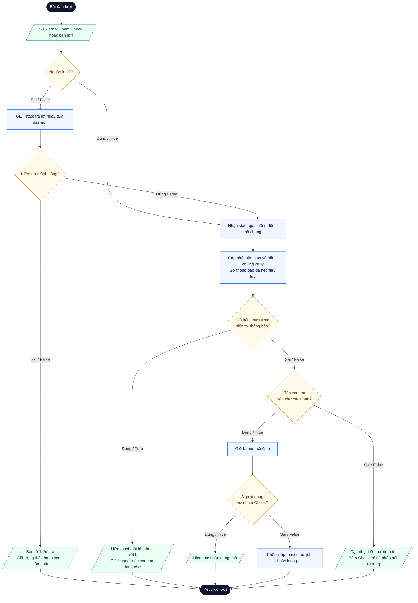
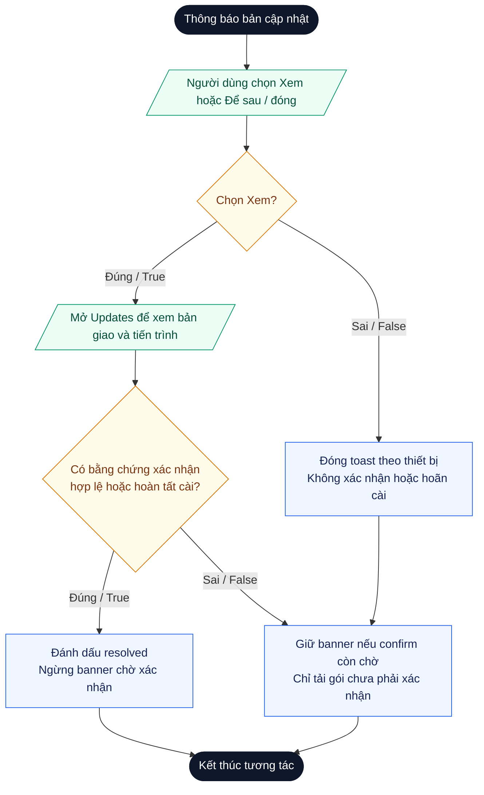

# Thiết kế luồng kiểm tra và thông báo cập nhật phần mềm OTSA

## 1. Tóm tắt

Tài liệu mô tả luồng giúp người dùng biết có bản cập nhật phần mềm do OTSD giao cho thiết bị OTSA ngay cả khi đang ở trang GUI khác, không cần thường xuyên mở trang Updates. Có hai đường phát hiện: (1) OTSA nhận thay đổi qua daemon v2 khi OTSD có bản giao mới; (2) OTSA chủ động kiểm tra khi người dùng bấm **Check for updates** hoặc khi bộ hẹn giờ đến hạn (mặc định 30 phút, chỉnh được).

## 2. Thuật ngữ và phạm vi

| Thuật ngữ | Ý nghĩa trong tài liệu |
| --- | --- |
| OTSD (SD) | Phía máy chủ quản lý, giao bản cập nhật cho thiết bị |
| OTSA (SA) | Phía thiết bị, gồm backend và GUI quản trị |
| Daemon v2 | Tiến trình trên OTSA đồng bộ state từ OTSD bằng HTTP GET long-poll |
| Assignment (bản giao) | Một bản cập nhật phần mềm được OTSD giao cho thiết bị, có định danh/revision/hash |
| Chính sách `confirm` | Bản giao cần người dùng xác nhận trước khi cài |
| Chính sách `auto` | Bản giao được xử lý tự động theo chính sách và điều kiện hiện có |

## 3. Hiện trạng

Daemon v2 nhận state qua HTTP GET long-poll. Trong `v2_sync.py::poll()`, khi đã có revision, client dùng `/state?wait=55` kèm `If-None-Match`; khi lấy đầy đủ dùng `/state`. Con số 55 giây là thời gian chờ của request, không phải cứ đủ 55 giây mới biết có thay đổi: khi OTSD có thay đổi, kết nối đang chờ được trả kết quả ngay.

Vì vậy, cụm "SD gửi thông báo" được hiểu là SD trả thay đổi qua kết nối v2 đang chờ, rồi SA tạo thông báo trên GUI. Không cần xây thêm kênh push riêng và không để SD trực tiếp mở popup trên trình duyệt.

Theo đối chiếu ghi trong báo cáo tiến độ, nút Status **Check for updates** hiện gọi `/api/otsa_update/package/poll` và ở chế độ v2 chỉ đọc snapshot local. Thiết kế dưới đây bổ sung kiểm tra trực tiếp OTSD cho thao tác chủ động; nút hiện tại chưa thực hiện hành vi mới này.

## 4. Yêu cầu và phần đã thống nhất

1. Khi OTSD có bản giao mới, OTSA nhận qua daemon v2 và hiển thị thông báo lần đầu.
2. OTSA có thể chủ động kiểm tra khi người dùng bấm **Check for updates** hoặc khi bộ hẹn giờ đến hạn; nếu có bản cập nhật phù hợp thì hiển thị thông báo.
3. Chu kỳ kiểm tra mặc định là **30 phút**, có ô chỉnh số phút trên OTSA. Đây chỉ là lịch kiểm tra thông tin cập nhật phần mềm.
4. Việc kiểm tra chủ động dùng một yêu cầu GET trả lời ngay (anh Dương đã đồng ý hướng này). Trong điều kiện bình thường, kết quả có thể giống trạng thái daemon đã nhận; tính năng phục vụ thao tác kiểm tra và thông báo theo yêu cầu, không chứng minh daemon đang thiếu đồng bộ.

## 5. Thiết kế đề xuất

### 5.1. Ba nguồn sự kiện

| Nguồn | Khi nào xảy ra | Cách thực hiện |
| --- | --- | --- |
| `v2` | OTSD có state mới | Daemon v2 nhận qua long-poll như hiện tại, không đợi mốc 30 phút |
| `manual` | Người dùng bấm Check for updates | Yêu cầu force-fetch GET state từ OTSD, trả lời ngay |
| `timer` | Đến lịch kiểm tra | Bộ hẹn giờ ở backend thực hiện cùng thao tác như `manual` |

Mỗi lượt xử lý mang theo thuộc tính `trigger` (`v2`, `manual` hoặc `timer`) để các bước sau biết nguồn gốc, không phải suy ngược lại.

### 5.2. Luồng xử lý một lượt

1. Nhận sự kiện kèm `trigger`.
2. Nếu `trigger` là `manual` hoặc `timer`: gửi force-fetch GET đến OTSD qua đường đồng bộ chung (xem mục 6.1). Nếu thất bại, ghi trạng thái "kiểm tra thất bại", giữ dữ liệu và mốc thành công gần nhất, kết thúc lượt.
3. Hợp nhất state nhận được vào luồng đồng bộ chung: chống lùi state, xử lý trùng.
4. Cập nhật trạng thái hiển thị trên GUI; gỡ thông báo của bản đã hết hiệu lực (đã xác nhận, đã cài, bị thu hồi hoặc bị thay thế).
5. So khớp định danh bản giao với bản đã có thông báo:
   - Bản giao mới chưa từng thông báo: tạo bản ghi thông báo và hiển thị toast (lần đầu).
   - Bản `confirm` vẫn đang chờ: giữ banner cố định; chỉ hiện lại toast khi `trigger` là `manual`.
   - Không có bản chờ: nếu `trigger` là `manual`, hiển thị phản hồi "Đã kiểm tra lúc …, không có bản mới"; các trường hợp khác không tạo thông báo.
6. Kết thúc lượt. "Kết thúc lượt" không có nghĩa dừng daemon hay bộ hẹn giờ.

### 5.3. Mô hình trạng thái thông báo

Trạng thái được lưu ở backend, gắn với định danh bản giao và **theo thiết bị** (không theo từng người dùng). Một người xử lý thì thông báo biến mất cho mọi phiên.

| Trạng thái | Ý nghĩa | Chuyển sang |
| --- | --- | --- |
| `unseen` | Đã tạo, chưa hiển thị cho người dùng nào | `seen` khi GUI hiển thị |
| `seen` | Đã hiển thị toast | `snoozed`, `resolved` |
| `snoozed` | Người dùng chọn Để sau hoặc đóng toast | `resolved` |
| `resolved` | Đã xác nhận, đã cài, bị thu hồi hoặc bị thay thế | (kết thúc) |

Bản giao còn ở `unseen`/`seen`/`snoozed` mà chính sách là `confirm` nghĩa là vẫn chờ xác nhận và được hiển thị bằng banner cố định. Khi GUI mở lại sau thời gian đóng trình duyệt, bản `unseen` hiển thị như thông báo mới.

### 5.4. Quy tắc hiển thị

- **Toast** chỉ xuất hiện ở lần phát hiện đầu tiên và khi người dùng bấm Check mà có bản đang chờ.
- **Banner/huy hiệu cố định** trên header của mọi trang đã đăng nhập (ví dụ "1 bản cập nhật đang chờ xác nhận") hiển thị liên tục cho đến khi bản được xác nhận, bị thu hồi hoặc bị thay thế.
- Không tạo popup lặp lại mỗi lần daemon long-poll nhận lại cùng trạng thái, và không tạo popup mỗi chu kỳ kiểm tra.
- Toast có nút **Xem bản cập nhật** (mở trang Updates) và **Để sau**/đóng. Mở trang Updates **không đồng nghĩa** đồng ý cài.
- GUI hiển thị phiên bản, trạng thái và thời điểm kiểm tra thành công gần nhất.
- Khi trình duyệt chưa mở, backend vẫn lưu trạng thái chờ; người dùng thấy thông tin khi mở GUI. Không cam kết thông báo hệ điều hành khi trình duyệt đã đóng.

### 5.5. Bản `confirm` và bản `auto`

**Bản `confirm`:** Để sau chỉ đóng toast hiện tại; assignment vẫn được giữ và chưa được xác nhận cài. Banner vẫn còn. Nhắc lại được xác định theo trạng thái (cùng bản vẫn chờ xác nhận), không phụ thuộc người dùng đã bấm gì: kể cả người đã mở trang Updates rồi thoát mà không xác nhận. Khi có bằng chứng người dùng đã xác nhận hoặc bắt đầu cài, bản đã hoàn tất hoặc bị thu hồi/thay thế thì ngừng nhắc "chờ xác nhận" cho bản đó. Tải/xác minh trước xác nhận không làm mất banner chờ. Lỗi tải/cài có trạng thái lỗi riêng, không tự đổi thành yêu cầu xác nhận mới.

**Bản `auto`:** tiếp tục tuân thủ chính sách cập nhật hiện có và các điều kiện cho phép thực thi. Thông báo chỉ để biết trạng thái; đóng thông báo không hủy hoặc hoãn việc cài tự động. Không thêm nút Để sau mang nghĩa hoãn cài khi chưa có yêu cầu riêng.

**Nguyên tắc chung:** kiểm tra, tải, xác minh và cài đặt là các bước khác nhau. Tính năng Check mới không tự cấp quyền cài, không bật execution gate và không bỏ qua kiểm chữ ký/hash. Thao tác Check không được xem là sự đồng ý cài đặt của người dùng.

### 5.6. Kiểm tra theo lịch

- Bộ hẹn giờ chạy ở backend OTSA để hoạt động cả khi không mở trang Updates hoặc trình duyệt.
- Mặc định 30 phút; người dùng lưu chu kỳ mới trên OTSA. Giá trị được validate **phía server**: đề xuất giới hạn dưới 5 phút, giới hạn trên 24 giờ, nhằm tránh dồn tải lên OTSD.
- Thêm jitter ngẫu nhiên nhỏ (đề xuất ±30 giây) để nhiều thiết bị cùng mặc định 30 phút không gọi OTSD đồng thời.
- Lưu mốc lần kiểm tra gần nhất; sau khi dịch vụ khởi động lại, tính lần chạy kế tiếp từ mốc đã lưu. Nếu lỡ lịch thì kiểm bù một lần khi daemon hoạt động trở lại, không chạy lại từng chu kỳ đã bỏ lỡ.
- Nếu backend chạy nhiều process/worker, bảo đảm chỉ một bộ hẹn giờ hoạt động.
- Khi đến hạn, thực hiện đúng thao tác như nút Check (`trigger = timer`). Việc đổi chu kỳ có hiệu lực từ lần hẹn kế tiếp.
- Không reset hay thay đổi vòng long-poll v2 để tạo lịch này.

### 5.7. Xử lý lỗi kiểm tra

- Không liên lạc được OTSD hoặc OTSD trả lỗi: báo "kiểm tra thất bại", **không** báo "không có cập nhật". Giữ dữ liệu gần nhất và đánh dấu mốc kiểm tra thành công gần nhất.
- Phân biệt mất kết nối với lỗi xác thực/chứng chỉ trong thông điệp hiển thị.
- Lỗi chỉ cập nhật trạng thái trên GUI, không tạo thông báo lặp lại mỗi chu kỳ.

## 6. Điều kiện kỹ thuật cần giữ

### Sơ đồ phát hiện và thông báo

Hình bình hành biểu diễn dữ liệu/tương tác vào ra; hình thoi là điều kiện với hai nhánh Đúng/Sai; hình chữ nhật là bước xử lý; hình bo tròn là đầu/cuối một lượt. Kết thúc lượt không dừng daemon.

### Sơ đồ xử lý thông báo

Nhánh `auto` tuân thủ chính sách cài hiện có và không hiện banner “chờ xác nhận”. Thu hồi/thay thế bản giao cũng kết thúc thông báo cũ qua sơ đồ phía trên.

### 6.1. Đồng thời

Long-poll và GET chủ động có thể chạy gần nhau. Để không ghi đè state mới bằng phản hồi cũ, không xử lý/cài/report hai lần và không mở hai thông báo cho một lần phát hiện:

- Check và timer gửi yêu cầu force-fetch vào **cùng worker đồng bộ** với daemon v2, tuần tự hóa bằng lock, thay vì tạo một đường ghi riêng.
- Revision của contract hiện tại là chuỗi định danh không có thứ tự lớn/nhỏ được bảo đảm. Dùng số thứ tự request và cơ chế nhận state hiện có để bỏ phản hồi đến muộn của request cũ; không so chuỗi revision như số phiên bản. Muốn phát hiện server tự trả snapshot cũ trong một request mới cần OTSD cung cấp contract thứ tự riêng.
- Thông báo được khử trùng theo định danh bản giao (ràng buộc duy nhất cho mỗi bản giao).

### 6.2. Nhận diện bản giao

Dùng định danh/revision/hash mà contract thực tế cung cấp. Không chỉ dựa vào chuỗi version hoặc revision của toàn bộ state, vì thay đổi firewall hay Suricata không đồng nghĩa có bản cập nhật phần mềm mới.

### 6.3. Phân biệt trạng thái

Bản chờ xác nhận, bản đã xác nhận, bản đã cài, bản bị thu hồi và lỗi kiểm tra là các trạng thái khác nhau và phải được biểu diễn tách biệt.

### 6.4. Dùng chung luồng hiện có

Kết quả kiểm tra đi về cùng luồng xử lý assignment hiện có. Không gọi tùy tiện hàm tải/apply chỉ để tạo thông báo, và không tạo đường ghi assignment hay cài đặt độc lập.

## 7. Bảo mật

- Nội dung từ OTSD hiển thị lên GUI (tên bản, mô tả, ghi chú) phải được escape để tránh XSS.
- Endpoint Check cần bảo vệ CSRF, debounce ở giao diện và rate limit ở backend để tránh bị lạm dụng gọi OTSD liên tục.
- Ô chỉnh chu kỳ validate phía server; ghi log khi giá trị thay đổi.
- Nút "Xem bản cập nhật" chỉ điều hướng, không mang hành động cài trong URL.
- Yêu cầu GET tới OTSD dùng thông tin xác thực và endpoint hiện hành, không bổ sung kênh hay khóa mới.

## 8. Phân định: phần đã thống nhất và lựa chọn thiết kế

| Nội dung | Nguồn |
| --- | --- |
| Nhận bản mới qua v2 và thông báo lần đầu | Thống nhất (thầy) |
| Kiểm tra chủ động bằng nút Check và theo lịch | Thống nhất (thầy) |
| Chu kỳ mặc định 30 phút, chỉnh được | Thống nhất (thầy) |
| Dùng một GET trả lời ngay cho kiểm tra chủ động | Thống nhất (anh Dương) |
| Toast lần đầu + banner cố định thay cho popup lặp lại | **Lựa chọn thiết kế** |
| Nhắc lại theo trạng thái bản chờ xác nhận | **Lựa chọn thiết kế** |
| Trạng thái thông báo theo thiết bị, lưu ở backend | **Lựa chọn thiết kế** |
| Giới hạn chu kỳ 5 phút đến 24 giờ, jitter ±30 giây | **Lựa chọn thiết kế** |
| Check/timer đi chung worker đồng bộ có lock | **Lựa chọn thiết kế** |

Các lựa chọn thiết kế không mở rộng quyền cài đặt; chúng chỉ ảnh hưởng đến cách hiển thị và nhắc. Nếu thầy muốn mức nhắc mạnh hơn (ví dụ popup lặp lại), có thể điều chỉnh ở lớp toast mà không đổi mô hình dữ liệu.

## 9. Ca kiểm thử nghiệm thu

| Ca | Kết quả cần thấy | Trạng thái kiểm thử / phần còn chờ |
| --- | --- | --- |
| OTSD giao bản mới khi người dùng ở trang GUI khác | Nhận qua v2, hiện toast, không chờ đủ 30 phút | Đạt tự động phần lưu thông báo và toast ở Status. Chờ giao bản thật khi đang ở một trang GUI khác ngoài Software Update. |
| Bấm Check khi có bản mới | Có yêu cầu kiểm trực tiếp OTSD, thông tin bản giao hiện trên GUI | Đạt tự động phần GET tức thời qua Engine và toast bản chờ. Chờ GET tới OTSD thật và hiển thị bản giao mới. |
| Bấm Check khi không có bản mới | Phản hồi "không có bản mới" kèm thời điểm kiểm tra | Đạt tự động phản hồi không có bản mới; backend có kiểm mốc thành công. Chờ đối chiếu thông điệp và thời điểm sau GET thật. |
| Đến lịch mặc định hoặc chu kỳ đã chỉnh | Backend tự kiểm dù không mở Updates; dùng chu kỳ đã lưu | Đạt tự động lịch mặc định, đổi chu kỳ và kiểm bù; .56 đã trả mặc định 30 phút. Chờ quan sát GET theo lịch thật khi đóng GUI. |
| Đổi chu kỳ | Có hiệu lực từ lần hẹn kế tiếp; giá trị ngoài giới hạn bị từ chối ở server | Đạt tự động đổi lịch/lưu GUI; model thật chấp nhận 5/1440, từ chối 4/1441/5.5. Chờ thao tác GUI đăng nhập và quan sát lần kiểm theo chu kỳ mới. |
| Chọn Để sau với bản `confirm` | Không xác nhận cài; assignment vẫn chờ; banner còn | Đạt tự động backend và trình duyệt: Để sau giữ banner, không gọi endpoint cài. Chờ bản confirm thật. |
| Mở trang Updates rồi thoát mà không xác nhận | Banner vẫn còn; không coi là đồng ý cài | Đạt tự động phần Xem bản cập nhật không cấp quyền cài và trạng thái chờ vẫn giữ. Chờ thao tác mở/thoát với bản confirm thật. |
| Long-poll trả lại cùng bản nhiều lần | Không phát sinh toast trùng | Đạt tự động khử trùng khi nhận lại state và GUI đọc lại trạng thái. Chờ nhiều lượt long-poll thật cùng bản giao. |
| Đã xác nhận hoặc đã cài | Không nhắc như bản chưa xác nhận; trạng thái tiến trình vẫn đúng | Đạt tự động phần nhận bằng chứng xác nhận và hết trạng thái chờ; tải gói không bị coi là xác nhận. Chưa nghiệm thu đầy đủ tiến trình xác nhận/cài thật. |
| OTSD thu hồi hoặc thay bản đang chờ | Gỡ thông báo cũ, hiện đúng trạng thái/bản mới | Đạt tự động backend thu hồi/thay thế và GUI gỡ banner khi thu hồi. Chờ OTSD thu hồi/thay bản thật. |
| Bản `auto` | Tuân thủ chính sách hiện có; đóng thông báo không đổi quyền hoặc lịch cài | Đạt tự động: không hiện banner chờ xác nhận, thông báo không gọi endpoint cài. Chưa nghiệm thu tác động với lịch/quy trình auto thật. |
| OTSD mất kết nối hoặc trả lỗi | Báo kiểm tra thất bại, giữ và đánh dấu dữ liệu gần nhất; không báo "không có cập nhật" | Đạt tự động lỗi kết nối/chứng chỉ/xác thực và giữ dữ liệu cũ; GUI fixture đã kiểm lỗi chứng chỉ giữ banner. Chờ kiểm đầu-cuối với bản đang chờ và lỗi kết nối thật trong phạm vi được phép. |
| GET chủ động và long-poll hoàn tất đồng thời | Không lùi state, không cài/report hai lần, không nhân đôi thông báo | Đạt tự động từng phần: GET chung Engine, bỏ phản hồi cũ và khử trùng toast. Chưa có bằng chứng ca tích hợp đầy đủ cài/report đồng thời; chờ kiểm phối hợp. |
| OTSD chỉ đổi assignment firewall/Suricata | Không thông báo nhầm có cập nhật phần mềm mới | Đạt tự động ca đổi revision kèm firewall không tạo thông báo gói mới. Chờ ca Suricata riêng và giao assignment thật. |
| Nhiều tab/phiên cùng mở | Không nhân đôi thông báo; một người xử lý thì các phiên khác cùng cập nhật | Đạt tự động claim đồng thời ở backend và hai tab trình duyệt giả lập dùng chung trạng thái. Chờ nhiều phiên đăng nhập thật. |
| Đóng trình duyệt, bản mới đến, mở lại GUI | Thông báo (`unseen`) hiện khi mở lại | Đã kiểm tự động từng phần: lưu unseen và toast khi mở trang. Chưa có bằng chứng ca đầy đủ đóng trình duyệt → OTSD giao bản → mở lại; chờ kiểm thật. |
| Dịch vụ khởi động lại khi đang có bản chờ | Trạng thái thông báo và mốc kiểm tra được giữ | Đạt tự động mở lại Store giữ mốc hẹn và banner sau Để sau. Chờ restart dịch vụ thật khi có bản đang chờ, trong phạm vi được phép. |
| Phản hồi request cũ về sau khi request mới đã được nhận | Bị bỏ qua theo thứ tự request, không lùi state; không suy thứ tự từ chuỗi revision | Đạt tự động hai request chồng nhau với revision opaque, phản hồi cũ bị bỏ qua. Chưa có bằng chứng kiểm đầu-cuối độ trễ/phản hồi đảo thứ tự thật. |

## 10. Rủi ro và lưu ý

- Nếu chọn popup nhắc lặp lại mỗi chu kỳ, người dùng dễ bị làm phiền; banner cố định là phương án thay thế đã chọn.
- Hai đường (long-poll và GET chủ động) làm tăng độ phức tạp đồng thời; giảm thiểu bằng việc đi chung một worker và khử trùng theo định danh bản giao.

