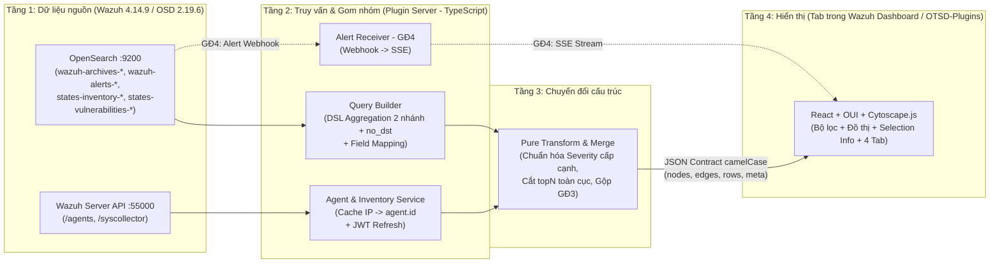
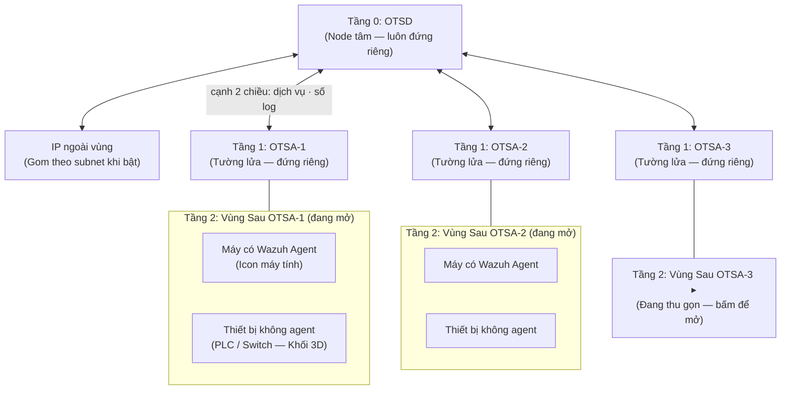

# Kế hoạch & Báo cáo Thiết kế: Công cụ Tìm kiếm và Trực quan hóa Đồ thị Kết nối (OTSD – OTSA – Wazuh)


## 1. Mục tiêu, bối cảnh & tóm tắt kết quả khảo sát nguồn dữ liệu

Nhóm xây dựng công cụ tìm kiếm và trực quan hóa log lưu trong **OpenSearch** của hệ thống giám sát mạng công nghiệp **OTSD – OTSA – Wazuh**. Công cụ chuyển đổi log thô thành **đồ thị kết nối có hướng** phục vụ điều tra và giám sát.

- **Vị trí trong hệ thống:** Công cụ **không thay thế** Wazuh Dashboard mà được phát triển thành **một plugin/tab trực quan hóa gốc** (`@2.19.6`) trong repo `ot/otsd/OTSD-Plugins`, tích hợp trực tiếp vào Wazuh Dashboard trên OTSD.
- **Trọng tâm điều tra:** Lấy thiết bị được tìm kiếm (mặc định là máy **OTSD**) làm trung tâm, vẽ các luồng gửi/nhận xung quanh kèm khung chi tiết và bảng dữ liệu đồng bộ.

Sau khi hoàn thành, người dùng trả lời được bốn câu hỏi nghiệp vụ cốt lõi:
1. OTSD (hoặc thiết bị đang tìm) đang kết nối với những máy nào, theo chiều nguồn → đích nào?
2. Kết nối qua dịch vụ/cổng nào, bao nhiêu bản ghi log/sự kiện, có cảnh báo hay không?
3. Mỗi thiết bị thuộc OTSA hoặc vùng mạng nào?
4. Thiết bị có cài Wazuh agent thì đang có lỗ hổng (CVE) gì và cài những phần mềm nào?

**Nguyên tắc kiểm soát phạm vi:**
- Mỗi phiên truy vấn đồ thị ở GĐ1–GĐ2 chỉ đọc từ **1 index** (tránh join chéo nặng nề).
- Khung chi tiết và các tab phụ tra cứu theo khóa `agent.id` / `agent.ip` của node đang chọn từ các nguồn cố định của Wazuh (`wazuh-states-inventory-*`, `wazuh-states-vulnerabilities-*`, `wazuh-alerts-*`, Wazuh API `/agents`).
- Tách bạch rõ các tầng khó (lọc theo nhánh OTSA, ghép nhiều index + xử lý NAT, tự động mở đồ thị theo cảnh báo) sang các giai đoạn kế tiếp nhưng chừa sẵn khớp nối ngay từ GĐ1.

### 1.1. Tóm tắt kết quả khảo sát nguồn dữ liệu thực tế (Đã thực hiện trên `10.30.20.25`)

> [!IMPORTANT]
> Chi tiết bằng chứng, số liệu thống kê và 5 mẫu log JSON gốc xem tại **[bao_cao_khao_sat_1_1_otsd_25.md]**.

| Hạng mục khảo sát | Kết quả thực tế trên `10.30.20.25` (2026-11-26) | Tác động trực tiếp tới thiết kế |
| :--- | :--- | :--- |
| **1. Phiên bản & nền tảng** | **Wazuh `4.14.9`**, **OSD `2.19.6`** (`build 414902`), 12 plugin `otsd*` đang chạy `green`. Máy `10.30.20.26` hiện chưa kết nối được cổng `443`. | **Chốt PA A:** viết OSD Plugin gốc (`pluginPlatform.version: "2.19.6"`) trong `OTSD-Plugins`, dùng sẵn CI `quay.io/wazuh/osd-dev:2.19.6`. |
| **2. Log tường lửa OTSA (R1)** | **`wazuh-archives-4.x-*` ĐÃ BẬT** (`6.367.927` dòng), có `22.506` log `pf`/`filterlog` (`22.338 pass`, `168 block`), nhưng **92,5% (`5,89M` dòng) là telemetry** (`otsd-telemetry.json`). Còn `wazuh-alerts-4.x-*` (`2.927` dòng) chỉ có `6` dòng `data.srcip` + `80` dòng Suricata. | GĐ1 phải hỗ trợ cả `wazuh-archives-4.x-*` (nguồn lưu lượng chính) và `wazuh-alerts-4.x-*`; **bắt buộc lọc `exists` trường IP** để bỏ qua 92,5% rác telemetry. |
| **3. Hai bộ tên trường IP** | Tường lửa `pf`/`sshd` dùng **`data.srcip` / `data.dstip`** (`action`: `pass`/`block`). Riêng **Suricata OT** (`eve.json`, 80 alerts / 181 archives) dùng **`data.src_ip` / `data.dest_ip`**. | File `field mapping` phải khai báo thêm trường dự phòng (`altSrcIp`/`altDstIp`) nếu muốn hiển thị cả cảnh báo IDS Suricata OT. |
| **4. Kiểu trường IP (`_mapping`)** | Toàn bộ trường IP (`data.srcip`, `data.dstip`, `agent.ip`, `data.src_ip`, `data.dest_ip`) đều có kiểu **`keyword`**, **không phải `ip`**. `data.flow.pkts_toserver` cũng là `keyword`. | `terms` aggregation chạy trực tiếp; **NHƯNG GĐ2 không lọc CIDR gốc của OpenSearch được** (phải dùng `prefix`, `terms` theo IP hoặc bổ sung multi-field `ip`). |
| **5. Log OTSD (R2), R5 & NAT (R7)** | `wazuh.manager` (`000`) không có `agent.ip`; IP `10.30.20.25` xuất hiện `64` lần trong `archives` (`otsa-sa01 → .25:1514/1515`) và `11` lần trong Suricata. Có `3` log `sshd` thiếu `dstip` (xác nhận R5). `sa02–sa04` chưa gửi `pf`; các SA chỉ có 1 NIC nên **chưa kiểm chứng được NAT**. | Giữ nguyên nhánh `no_dst` + `exists: data.srcip`; cần xác minh NAT & bật `filterlog` cho `sa02–sa04` với thầy/nhóm OTSA. |
| **6. Nguồn cho 4 tab** | `wazuh-states-inventory-packages-*` (`1.058` dòng), `interfaces` (`26`), `networks` (`10`) và Wazuh API `/syscollector` đều chạy tốt. Index `wazuh-states-vulnerabilities-*` tồn tại nhưng đang có **`0` dòng** (do agent là FreeBSD). | Tab Phần mềm & MAC đọc trực tiếp từ `wazuh-states-inventory-*` hoặc `/syscollector`. Cần gắn thêm 1 agent Linux/Windows mẫu nếu muốn demo Tab Lỗ hổng (CVE). |

---

## 2. Phạm vi & phân chia giai đoạn

Dự án chia làm **4 giai đoạn** (GĐ1–GĐ3 hoàn thiện khung điều tra đa tầng, GĐ4 mở rộng cảnh báo gần thời gian thực). **Giai đoạn 1** là cột mốc lõi dùng để demo đầu tiên với giảng viên.

| Giai đoạn | Bộ lọc | Nguồn dữ liệu đồ thị | Chức năng chính |
| :--- | :--- | :--- | :--- |
| **GĐ1: Khung lõi** *(Demo đầu)* | **3 nấc:** Thời gian → Index *(hỗ trợ `wazuh-archives-4.x-*`, `wazuh-alerts-4.x-*`)* → IP/User *(mặc định điền sẵn IP OTSD)*. Bộ lọc phụ: mức cảnh báo chung, dịch vụ | **1 index** | Đồ thị lấy OTSD làm tâm; 5 vùng giao diện đồng bộ; 4 tab (Kết nối, Cảnh báo, Lỗ hổng, Phần mềm); hiển thị **nhãn & khung vùng OTSA** từ file cấu hình (và `otsd-device-groups`); gom theo vùng/subnet. Thiết kế sẵn khớp nối cho GĐ2–GĐ3. |
| **GĐ2: Lọc OTSA** | **4 nấc:** Thêm nấc chọn nhánh **OTSD / OTSA** (danh sách lấy từ `zones` / `otsaNodes`) | Vẫn **1 index** *(lọc vùng bằng `prefix` hoặc `terms` trên trường `keyword`)* | Chọn OTSA để lọc đồ thị và bảng theo vùng mạng tương ứng; tô viền node theo màu OTSA kèm chú thích. |
| **GĐ3: Đa index & NAT** | Cho chọn **1 index** tầng `OTSD ↔ OTSA` và **1 index** tầng `OTSA ↔ máy nội bộ` | **Nhiều index**, gộp cạnh theo khóa `src\|dst` | Vẽ đúng đường `OTSD → OTSA → máy phía sau` từ log thật; xử lý ánh xạ NAT dựa trên log của chính OTSA; bấm vào node OTSA để mở rộng (drill-down) các máy phía sau. |
| **GĐ4: Mở rộng — Cảnh báo gần thời gian thực** *(Làm sau khi vững khung cơ bản)* | Giữ nguyên + bộ lọc cảnh báo mới | Webhook từ Wazuh / OpenSearch Alerting + SSE *(hoặc WebSocket)* | Nhận alert tự động đẩy lên giao diện gần thời gian thực; hiển thị thông báo/danh sách alert mới và cho phép **mở nhanh hoặc tự động vẽ đồ thị** lấy thiết bị gây cảnh báo làm tâm. |

**Ngoài phạm vi dự án:**
- Trường **CWE** như mẫu giao diện tham khảo *(Wazuh không lưu CWE; thay bằng tên gói phần mềm bị lỗi và phiên bản)*.
- Gom nhóm **IPv6** *(khảo sát hiện có `0` bản ghi IPv6; nếu sau này có thì vẽ thành node riêng, không gom subnet)*.
- Thao tác **ghi hoặc sửa dữ liệu** trong Wazuh / OpenSearch *(công cụ chỉ có quyền đọc)*.
- *Tùy chọn (làm nếu còn thời gian):* Tra cứu tên hãng sản xuất theo địa chỉ MAC (bảng OUI).


---

## 3. Kiến trúc tổng thể, so sánh phương án & tích hợp tab Wazuh Dashboard

### 3.1. Kiến trúc pipeline 4 tầng



**Khớp nối thiết kế sẵn từ GĐ1 để mở rộng:**
1. **API nhận mảng index (`indices: string[]`):** GĐ1 truyền mảng 1 phần tử; GĐ3 truyền nhiều index (hoặc gọi thêm endpoint `POST /api/graph/expand` cho node OTSA).
2. **Hợp đồng JSON có sẵn trường mở rộng:** Node có sẵn `tier`, `parent`, `expandable`; Edge có sẵn `sources` (danh sách index đóng góp cạnh đó).
3. **Tách hàm `transform` thuần (pure function):** Tách bước *truy vấn 1 index* và bước *chuẩn hóa + gộp (merge)*. Khi lên GĐ3 chỉ cần chạy `transform` cho từng index rồi hợp nhất theo khóa `src|dst`.

### 3.2. So sánh và lựa chọn công nghệ

| Phương án | Ưu điểm | Nhược điểm | Kết luận |
| :--- | :--- | :--- | :--- |
| **Công cụ có sẵn** *(Grafana Node Graph, OpenSearch Dashboards Graph)* | Cài đặt nhanh, ít viết code. | Khó tùy biến giao diện 5 vùng đồng bộ theo mẫu thầy; khó xử lý nhánh `no_dst`, loại 92,5% rác telemetry trong `archives`, gom vùng OTSA động, hay tra cứu chéo Wazuh API. | **Không chọn** |
| **Plotly Dash / Streamlit** *(Python thuần)* | Dựng prototype rất nhanh, 1 ngôn ngữ. | Khó gắn mượt thành tab trong Wazuh Dashboard; hạn chế tương tác đồ thị nâng cao (compound node mở/thu gọn, tô sáng 2 chiều mượt); không khớp quy trình CI/CD của repo `OTSD-Plugins`. | **Không chọn** |
| **OSD Plugin gốc: React + Cytoscape.js + OUI + Server TypeScript** *(trong `OTSD-Plugins`)* | Khớp 100% hạ tầng `OT-CI` đã dựng sẵn (`quay.io/wazuh/osd-dev:2.19.6`, 12 plugin `otsd*` đang chạy ổn định); đồng bộ xác thực & giao diện OUI; tách biệt rõ `server/` (A) và `public/` (B); sẵn sàng cho SSE ở GĐ4. | Phải bám đúng phiên bản OSD `2.19.6` và quy ước build của `OTSD-Plugins`. | **Chốt chọn** |

### 3.3. Tích hợp thành 1 tab trong Wazuh Dashboard (Chốt Phương án A)

Qua khảo sát hạ tầng `OT-CI` và kiểm chứng trực tiếp 12 plugin `otsd*` trên `10.30.20.25`, nhóm **chốt Phương án A** làm phương án triển khai chính thức, giữ Phương án B làm dự phòng:

| Phương án | Kiến trúc & Quy trình build/deploy | Trạng thái |
| :--- | :--- | :--- |
| **Phương án A (Chính thức): OSD Plugin gốc trong `ot/otsd/OTSD-Plugins`** | Tạo 1 thư mục plugin mới trong repo `OTSD-Plugins` (nhánh dev `dev/main`, `pluginPlatform.version: "2.19.6"`): `public/` dùng React + OUI + Cytoscape.js (có thể tái sử dụng thành phần từ `otsdShared`), `server/` (TypeScript/Node.js) gọi thẳng OpenSearch client nội bộ của OSD + Wazuh API. CI tự động build ZIP trong image `quay.io/wazuh/osd-dev:2.19.6`, deploy lên `OTSD-Dev-CI` (`10.30.20.26`) và dựng preview trên `OTSD-Dev-CI-Live` (`10.30.20.25`). | **Đã chốt** *(cần thử cài Cytoscape vào plugin mẫu ở tuần 1 theo R10)* |
| **Phương án B (Dự phòng R10): Thin Plugin + iframe + FastAPI** | Chỉ kích hoạt nếu việc đóng gói Cytoscape.js trong `osd-dev:2.19.6` gặp lỗi không khắc phục được: dùng plugin vỏ mỏng đăng ký tab + nhúng `iframe` trỏ về web app React + FastAPI (`opensearch-py`) sau Reverse Proxy. | **Dự phòng** |

---

## 4. Mô hình mạng, quy ước đồ thị & bố cục giao diện

### 4.1. Mô hình mạng 3 tầng

Đồ thị luôn lấy **OTSD** (hoặc thiết bị đang tìm) làm tâm. Các tường lửa **OTSA** nằm ở tầng 1 (đứng độc lập làm nút trung gian, **không bị gộp vào khung Vùng OTSD**). Các thiết bị phía sau từng OTSA nằm trong khung bao (compound node) khai báo trong file `zones`. Trên giao diện thật, các node xếp vòng quanh tâm (bố cục `concentric`); sơ đồ dưới trình bày dạng cây để dễ theo dõi cấu trúc tầng:



> [!NOTE]
> Ở **GĐ1**, nhãn OTSA và khung vùng được gán từ file cấu hình `zones`, chưa đọc từ log tường lửa. Do đó các cạnh luôn phản ánh đúng những gì index đang chọn ghi nhận được (xem thêm **R7** về NAT).

### 4.2. Quy ước hiển thị Node và Cạnh

| Thành phần | Hình vẽ | Ghi chú |
| :--- | :--- | :--- |
| **OTSD** | Icon máy chủ, viền đậm, đặt ở giữa | Node tâm mặc định, không bao giờ bị gom vào nhóm. |
| **OTSA** | Icon tường lửa, nhãn là tên OTSA | Danh sách nhận diện theo `otsaIp` trong `zones`; **đứng riêng**, không bị gom vào vùng OTSD. |
| **Máy có Wazuh agent** | Icon máy tính | Bấm vào xem được OS, MAC, lỗ hổng (CVE), phần mềm. |
| **Máy không có agent** | Khối lập phương 3D | PLC, switch, thiết bị lạ; tab Lỗ hổng/Phần mềm hiển thị *"Không có agent"*. |
| **User** *(khi tìm theo User)* | Icon người | Làm node tâm, nối tới các IP mà user đó có log đăng nhập/tác động. |
| **Vùng / Nhóm subnet** | Khung bao *(compound node)* | Khi thu gọn hiển thị thành 1 node kèm ký hiệu `▸`. |

**Quy ước màu sắc (tách bạch giữa Mức cảnh báo và Trạng thái đang chọn):**
- **Màu theo mức cảnh báo cao nhất của node** *(dùng thang chung ở Mục 5.3)*:
  - **Xanh dương nhạt / Xám nhạt:** Bình thường / mức Thấp.
  - **Vàng:** Mức Trung bình.
  - **Cam:** Mức Cao.
  - **Đỏ:** Mức Nghiêm trọng.
  - **Xám (viền nét đứt):** Agent đã ngắt kết nối hoặc không có log trong khoảng thời gian chọn.
- **Trạng thái đang chọn (Selected):** Không dùng chung màu với trạng thái bình thường. Khi bấm chọn một node/cạnh, áp dụng **viền sáng đậm (halo)** cho đối tượng được chọn cùng các node lân cận, đồng thời **làm mờ (giảm opacity)** phần còn lại của đồ thị (tương tự demo *Wine & cheese* của Cytoscape).

**Quy ước cạnh:**
- Luôn dùng `curve-style: bezier` *(tránh `haystack` vì làm mất mũi tên chỉ hướng)*.
- Kết nối hai chiều vẽ thành **hai cạnh cong tách biệt** theo chiều `nguồn → đích`.
- Nhãn cạnh hiển thị dịch vụ và **số log** (ví dụ: `vnc · 120` hoặc `ssh, smb, +2 · 450`).
- Độ dày cạnh tỉ lệ (theo thang logarit) với số log; màu cạnh theo mức cảnh báo cao nhất trên cạnh đó.

### 4.3. Bố cục giao diện 5 vùng & tương tác đồng bộ

Giao diện bám sát mẫu giảng viên cung cấp, gồm 5 vùng:
1. **Thanh lọc (trên cùng):** GĐ1 gồm 3 nấc (`Thời gian → Index → IP/User`, mặc định điền IP OTSD) + bộ lọc phụ (`Mức cảnh báo`, `Dịch vụ`, `Gom subnet /16 /24 /28`). GĐ2 thêm nấc `OTSD/OTSA`.
2. **Dòng `Details for <IP / Tên máy tâm>`:** Hiển thị nhanh OS, IP, MAC, OTSA/vùng, trạng thái agent của node đang làm tâm.
3. **Vùng Đồ thị Cytoscape (bên trái):** Bấm node → xem chi tiết & lọc bảng; bấm đúp node → đặt làm tâm mới và tải lại đồ thị; bấm khung vùng/nhóm → mở rộng hoặc thu gọn; rê chuột → hiện tooltip.
4. **Khung `Selection info` (bên phải):**
   - *Khi chọn Node:* IP, tên agent, OS, MAC, OTSA/vùng, số log gửi/nhận, số kết nối, mức cảnh báo cao nhất, lần thấy gần nhất.
   - *Khi chọn Cạnh:* Chi tiết luồng một chiều (`src → dst`), danh sách dịch vụ/cổng, số log, mức cao nhất.
   - *Khi chọn Nhóm/Vùng:* Số lượng máy trong nhóm, tổng số log, mức cảnh báo cao nhất.
5. **Bảng tổng quan 4 tab (bên dưới):** Hỗ trợ phân trang, sắp xếp, lọc cột, **xuất CSV**, đồng bộ click hai chiều với đồ thị (bấm dòng trong bảng → tô sáng cạnh tương ứng trên đồ thị).

| Tab | Cột chính | Nguồn dữ liệu *(đã xác minh trên Wazuh `4.14.9`)* | Phạm vi thời gian |
| :--- | :--- | :--- | :--- |
| **Kết nối** | IP nguồn, IP đích, dịch vụ/cổng, số log, mức cao nhất, lần thấy cuối | Index đang chọn ở nấc 2 (`wazuh-archives-4.x-*` hoặc `wazuh-alerts-4.x-*`) | **Theo thanh lọc Thời gian** |
| **Cảnh báo** | Thời gian, Rule ID, mô tả, mức cảnh báo (`rule.level`) | `wazuh-alerts-4.x-*` lọc theo `agent.ip` hoặc `agent.name` *(tránh mất lịch sử khi agent CI-Live đổi `agent.id`)* | **Theo thanh lọc Thời gian** |
| **Lỗ hổng** | CVE, điểm CVSS, mức độ, gói phần mềm, phiên bản, ngày phát hiện | `wazuh-states-vulnerabilities-wazuh.manager` *(hiện `0` dòng trên FreeBSD; cần agent Linux/Windows khi demo)* | **Trạng thái hiện tại** *(không theo thanh thời gian)* |
| **Phần mềm** | Tên gói, phiên bản, nhà phát hành, ngày cài đặt | `wazuh-states-inventory-packages-wazuh.manager` (`1.058` dòng) hoặc `/syscollector/{agent_id}/packages` | **Trạng thái hiện tại** *(không theo thanh thời gian)* |

**Ánh xạ các trường thay thế so với mẫu tham khảo (do Wazuh không có sẵn):**
- `roles`, `is learned` → thay bằng **nhóm agent (`group`, liên kết `otsd-device-groups`)** và **trạng thái agent (`status`)**.
- `zone` → thay bằng **tên OTSA / tên vùng** từ file cấu hình `zones`.
- `CWE` → thay bằng **gói phần mềm bị lỗi và phiên bản**.

---

## 5. Nguồn dữ liệu, file cấu hình & thang cảnh báo chung

### 5.1. Bảng ánh xạ nguồn dữ liệu thực tế trong OTSD (`Wazuh 4.14.9`)

| Thông tin | Nguồn đã xác minh trên `10.30.20.25` | Ghi chú kỹ thuật |
| :--- | :--- | :--- |
| Đồ thị & tab Kết nối | `wazuh-archives-4.x-*` *(lưu lượng `pf` đầy đủ)* hoặc `wazuh-alerts-4.x-*` *(chỉ cảnh báo)* | GĐ1–GĐ2: 1 index; GĐ3: tối đa 2 index. Phải lọc `exists` trường IP để bỏ 92,5% telemetry trong `archives`. |
| Tên máy, OS, IP, trạng thái, nhóm | Wazuh Server API `GET /agents` + `otsd-device-groups` | Cache bảng `IP → agent` (TTL 5–10 phút). Có thể đối chiếu thêm `wazuh-states-inventory-networks-*` cho máy nhiều NIC. |
| MAC, card mạng | `wazuh-states-inventory-interfaces-wazuh.manager` hoặc `GET /syscollector/{agent_id}/netiface` | Ưu tiên đọc trực tiếp từ OpenSearch để giảm tải gọi Wazuh API. |
| Tab Phần mềm | `wazuh-states-inventory-packages-wazuh.manager` hoặc `GET /syscollector/{agent_id}/packages` | Đã xác minh có `1.058` bản ghi thật trên `.25`. |
| Tab Lỗ hổng | `wazuh-states-vulnerabilities-wazuh.manager` | Index đã tồn tại (Wazuh `4.14.9`), hiện có `0` bản ghi vì agent trên `.25` đều là FreeBSD. |
| Tab Cảnh báo | `wazuh-alerts-4.x-*` | Lọc theo `agent.ip` hoặc `agent.name` để không mất cảnh báo cũ khi agent re-enroll đổi `agent.id`. |

### 5.2. File cấu hình hệ thống (Đồng bộ theo dữ liệu thực tế `10.30.20.25`)

Toàn bộ tham số cấu hình đặt tập trung trong một file JSON (phần `zones` LAN phía sau từng OTSA sẽ bổ sung sau khi chốt topology mạng thật ở Mục 11):

```json
{
  "otsd": {
    "ip": "10.30.20.25",
    "name": "OTSD-Dev-CI-Live"
  },
  "zones": [
    { "cidr": "10.30.20.0/24", "name": "Mạng quản trị Lab OTSD-OTSA" }
  ],
  "otsaNodes": [
    { "ip": "10.30.20.35", "name": "otsa-sa01", "group": "default" },
    { "ip": "10.30.20.36", "name": "otsa-sa02", "group": "section-01" },
    { "ip": "10.30.20.37", "name": "otsa-sa03", "group": "section-01" },
    { "ip": "10.30.20.38", "name": "otsa-sa04", "group": "section-01" }
  ],
  "defaults": {
    "timeRange": "24h",
    "timeZone": "+07:00",
    "topN": 50,
    "groupingThreshold": 25,
    "groupingTopN": 500,
    "queryTimeoutSec": 10
  },
  "ports": {
    "22": "ssh", "53": "dns", "80": "web", "123": "ntp", "443": "web",
    "445": "smb", "1514": "wazuh-agent", "1515": "wazuh-enroll",
    "3389": "rdp", "5900": "vnc", "502": "modbus", "102": "s7"
  },
  "edgeSeverityRules": {
    "repeatBlockThreshold": 20,
    "otPorts": [502, 102]
  },
  "indices": {
    "wazuh-archives-4.x-*": {
      "timestamp": "timestamp",
      "srcIp": "data.srcip",
      "dstIp": "data.dstip",
      "altSrcIp": "data.src_ip",
      "altDstIp": "data.dest_ip",
      "dstIpFallback": "agent.ip",
      "dstPort": "data.dstport",
      "altDstPort": "data.dest_port",
      "username": "data.dstuser",
      "agentName": "agent.name",
      "agentId": "agent.id",
      "severityMode": "pf_action_or_level",
      "levelField": "rule.level",
      "actionField": "data.action",
      "actionValues": { "pass": "low", "block": "medium" },
      "packetsField": null,
      "bytesField": null
    },
    "wazuh-alerts-4.x-*": {
      "timestamp": "timestamp",
      "srcIp": "data.srcip",
      "dstIp": "data.dstip",
      "altSrcIp": "data.src_ip",
      "altDstIp": "data.dest_ip",
      "dstIpFallback": "agent.ip",
      "dstPort": "data.dstport",
      "altDstPort": "data.dest_port",
      "username": "data.dstuser",
      "agentName": "agent.name",
      "agentId": "agent.id",
      "severityMode": "numeric_level",
      "levelField": "rule.level",
      "actionField": "data.action",
      "packetsField": null,
      "bytesField": null
    }
  }
}
```

**Quy tắc bắt buộc khi ánh xạ trường (đã đối chiếu `_mapping` thật):**
1. **Xử lý thiếu `dstIp` & lọc rác telemetry:** Log `sshd` (`rule.id: 5710`) thiếu `dstIp` → bắt buộc fallback sang `dstIpFallback` (`agent.ip`) ở cả tầng lọc lẫn nhánh `no_dst`, đồng thời bắt buộc `exists: srcIp` để loại bỏ **92,5% rác `otsd-telemetry.json`** trong `archives` và các alert nội bộ (`rootcheck`, `sca`, `syscheck`).
2. **Xử lý 2 bộ tên trường IP trong cùng 1 index:** Tường lửa `pf`/`sshd` dùng `data.srcip`/`data.dstip`, còn IDS **Suricata OT** dùng `data.src_ip`/`data.dest_ip` (`altSrcIp`/`altDstIp`). Nhóm chốt ở Mục 11 xem GĐ1 có bật truy vấn gộp thêm nhánh Suricata hay không.
3. **Kiểu trường thực tế (`keyword`):** Mọi trường IP đều là `keyword` nên aggregation `terms` chạy trực tiếp (không cần `.keyword`), nhưng ở GĐ2 **không lọc CIDR trực tiếp được trên OpenSearch** (phải dùng `prefix` query cho `/16`, `/24`, `terms` theo danh sách IP, hoặc bổ sung multi-field `ip` vào index template).
4. **Phân biệt "số log" và "số gói":** `doc_count` là **số bản ghi log/sự kiện**. Khảo sát cho thấy log `pf` không có trường gói tin, còn `data.flow.pkts_toserver`/`bytes_toserver` của Suricata đang có kiểu `keyword` (không chạy `sum` được), nên ở GĐ1 đặt `packetsField`/`bytesField = null`.

### 5.3. Thang cảnh báo chung

Để màu sắc và bộ lọc nhất quán giữa `wazuh-alerts-4.x-*` và `wazuh-archives-4.x-*`, hệ thống quy đổi về 4 mức chuẩn và **tách rõ hai cấp đánh giá**:
- **Cấp bản ghi (khi lọc/truy vấn OpenSearch):** Dựa trên trường sẵn có của từng dòng log (`rule.level`, `data.action` của `pf`, hoặc `data.alert.severity` của Suricata).
- **Cấp cạnh sau tổng hợp (tại tầng `transform`):** Quy tắc *`block` lặp lại vượt ngưỡng* **không quy đổi được trên từng bản ghi** mà tính từ tổng số log `block` trên mỗi cạnh sau khi OpenSearch đã aggregation `data.action`.

| Mức chuẩn (`severity`) | Wazuh `rule.level` *(cấp bản ghi)* | OPNsense `pf` `data.action` *(cấp bản ghi)* | Suricata `data.alert.severity` *(nếu bật — ngược chiều)* | Quy tắc nâng mức ở cấp cạnh *(tầng `transform`)* | Màu hiển thị |
| :--- | :--- | :--- | :--- | :--- | :--- |
| `low` (Thấp) | `0 – 6` | `pass` | `"4"` | — | Xanh dương nhạt / Xám nhạt |
| `medium` (Trung bình) | `7 – 11` | `block` | `"3"` | — | Vàng |
| `high` (Cao) | `12 – 14` | `block` vào cổng OT (`502`, `102`) | `"2"` | Tổng số log `block` trên cạnh ≥ `repeatBlockThreshold` *(mặc định `20`)* | Cam |
| `critical` (Nghiêm trọng) | `15` | *(Nhóm chốt theo rule tường lửa thực tế)* | `"1"` *(ví dụ `OTSA-SEV-1`)* | *(Nhóm chốt nếu có ngưỡng cực đoan)* | Đỏ |

---

## 6. Truy vấn OpenSearch mẫu & hợp đồng dữ liệu JSON

### 6.1. Truy vấn Aggregation mẫu cho GĐ1 (2 nhánh ngang cấp + nhánh tách riêng `no_dst`)

> [!IMPORTANT]
> **Các nguyên tắc kỹ thuật bắt buộc trong truy vấn GĐ1 (đã đối chiếu thực tế trên `10.30.20.25`):**
> 1. **Không dùng `missing: "__MISSING_DST__"` trên trường `dstIp`:** Tránh lỗi kiểu dữ liệu nếu sau này chuyển trường sang kiểu `ip`, và tránh tính gộp `ports`/`maxLevel`/`actions`/`latest` chung cho nhiều cạnh fallback. Tách riêng nhánh `no_dst` và đặt các sub-aggregation bên dưới `agent.ip`.
> 2. **Bắt buộc `exists: data.srcip` ở mệnh đề fallback và nhánh `inbound`:** Loại bỏ tức thì **92,5% rác `otsd-telemetry.json` (~5,89 triệu dòng)** trong `wazuh-archives-4.x-*` và toàn bộ alert nội bộ (`rootcheck`, `sca`, `syscheck`) không liên quan mạng, đảm bảo số liệu khớp tuyệt đối với Discover.
> 3. **Loại cạnh tự nối (`src === dst`):** Nhánh `no_dst` loại sẵn `agent.ip == tâm`, và tầng `transform` luôn lọc bỏ mọi cạnh có `src === dst`.
> 4. **Định nghĩa nhất quán cho `topN`:** `topN` (mặc định `50`, hoặc `500` khi bật gom) là **tổng số cạnh tối đa hiển thị trên toàn đồ thị**. Backend lấy dư ở từng nhánh (`size: topN`), sau đó `transform` gộp các cạnh trùng khóa `src|dst`, loại self-loop rồi **cắt lấy đúng `topN` cạnh đứng đầu** theo thứ tự ưu tiên **mức cảnh báo giảm dần → số log giảm dần**. Số log của các cạnh bị cắt cộng dồn vào `meta.otherLogs` cùng với `sum_other_doc_count` từ OpenSearch.

Ví dụ truy vấn tìm các kết nối quanh OTSD (`10.30.20.25`) trên index `wazuh-archives-4.x-*` trong 24 giờ qua *(có sub-agg `actions` trên `data.action` để đếm số lần `pass`/`block` phục vụ quy tắc nâng mức ở Mục 5.3; nếu bật thêm nguồn Suricata `altSrcIp`/`altDstIp`, backend chạy thêm truy vấn tương ứng trên `data.src_ip`/`data.dest_ip` rồi gộp trong `transform`)*:

```json
{
  "size": 0,
  "timeout": "10s",
  "query": {
    "bool": {
      "filter": [
        { "range": { "timestamp": { "gte": "now-24h", "time_zone": "+07:00" } } },
        {
          "bool": {
            "should": [
              { "term": { "data.srcip": "10.30.20.25" } },
              {
                "bool": {
                  "filter": [
                    { "exists": { "field": "data.srcip" } },
                    { "term": { "data.dstip": "10.30.20.25" } }
                  ]
                }
              },
              {
                "bool": {
                  "must_not": [{ "exists": { "field": "data.dstip" } }],
                  "filter": [
                    { "exists": { "field": "data.srcip" } },
                    { "term": { "agent.ip": "10.30.20.25" } }
                  ]
                }
              }
            ],
            "minimum_should_match": 1
          }
        }
      ]
    }
  },
  "aggs": {
    "outbound": {
      "filter": { "term": { "data.srcip": "10.30.20.25" } },
      "aggs": {
        "total_peers": { "cardinality": { "field": "data.dstip" } },
        "peers": {
          "terms": { "field": "data.dstip", "size": 50 },
          "aggs": {
            "ports": { "terms": { "field": "data.dstport", "size": 5 } },
            "actions": { "terms": { "field": "data.action", "size": 5 } },
            "maxLevel": { "max": { "field": "rule.level" } },
            "latest": {
              "top_hits": {
                "size": 1,
                "sort": [{ "timestamp": "desc" }],
                "_source": ["agent.name", "agent.id", "agent.ip", "timestamp"]
              }
            }
          }
        },
        "no_dst": {
          "filter": {
            "bool": {
              "must_not": [
                { "exists": { "field": "data.dstip" } },
                { "term": { "agent.ip": "10.30.20.25" } }
              ]
            }
          },
          "aggs": {
            "total_peers": { "cardinality": { "field": "agent.ip" } },
            "by_agent": {
              "terms": { "field": "agent.ip", "size": 50 },
              "aggs": {
                "ports": { "terms": { "field": "data.dstport", "size": 5 } },
                "actions": { "terms": { "field": "data.action", "size": 5 } },
                "maxLevel": { "max": { "field": "rule.level" } },
                "latest": {
                  "top_hits": {
                    "size": 1,
                    "sort": [{ "timestamp": "desc" }],
                    "_source": ["agent.name", "agent.id", "agent.ip", "timestamp"]
                  }
                }
              }
            }
          }
        }
      }
    },
    "inbound": {
      "filter": {
        "bool": {
          "filter": [{ "exists": { "field": "data.srcip" } }],
          "should": [
            { "term": { "data.dstip": "10.30.20.25" } },
            {
              "bool": {
                "must_not": [{ "exists": { "field": "data.dstip" } }],
                "filter": [{ "term": { "agent.ip": "10.30.20.25" } }]
              }
            }
          ],
          "minimum_should_match": 1
        }
      },
      "aggs": {
        "total_peers": { "cardinality": { "field": "data.srcip" } },
        "peers": {
          "terms": { "field": "data.srcip", "size": 50 },
          "aggs": {
            "ports": { "terms": { "field": "data.dstport", "size": 5 } },
            "actions": { "terms": { "field": "data.action", "size": 5 } },
            "maxLevel": { "max": { "field": "rule.level" } },
            "latest": {
              "top_hits": {
                "size": 1,
                "sort": [{ "timestamp": "desc" }],
                "_source": ["agent.name", "agent.id", "agent.ip", "timestamp"]
              }
            }
          }
        }
      }
    }
  }
}
```

**Các quy tắc bắt buộc khi dựng truy vấn và xử lý ở Backend:**
- **Luôn có `"minimum_should_match": 1`:** Trong một khối `bool` đã có `filter`, nếu thiếu dòng này thì `should` trở thành tùy chọn và truy vấn trả về toàn bộ log.
- **Gộp nhánh `outbound.peers` + `outbound.no_dst.by_agent` và cắt `topN` toàn cục:** Nếu cùng một IP đích xuất hiện ở cả hai nhánh, `transform` cộng dồn `count`, hợp `ports`/`actions`, lấy `maxLevel` và `latest` mới nhất; loại bỏ mọi cạnh `src === dst`; áp dụng quy tắc nâng mức `repeatBlockThreshold`; sau đó cắt giữ tối đa `topN` cạnh cho toàn bộ đồ thị.
- **Tính `meta.otherLogs` và `meta.truncated`:** Cộng `sum_other_doc_count` của `outbound.peers`, `outbound.no_dst.by_agent`, `inbound.peers` với tổng `count` của các cạnh bị cắt ngoài `topN` tại `transform`. Nếu `otherLogs > 0` hoặc tổng cạnh trước khi cắt vượt `topN` thì đặt `truncated = true`.
- **Truy vấn theo User (GĐ1) và lọc theo nhánh OTSA (GĐ2):** Thay mệnh đề lọc IP tâm bằng `term` trên `username` (hoặc `should` theo `prefix`/`terms` trên `srcIp`/`dstIp` kiểu `keyword` kèm `minimum_should_match: 1` và `exists` trên `srcIp`), và dùng aggregation **`multi_terms`** của OpenSearch trên cặp `[srcIp, dstIp]` với `size: topN`.
- **Múi giờ:** Truyền `time_zone` khớp tuyệt đối với cấu hình Wazuh Discover để số liệu khớp khi đối chiếu.

### 6.2. Hợp đồng JSON giữa Backend và Frontend

Hai mảng Dữ liệu (A) và Giao diện (B) chốt hợp đồng này ở **Mục 1.3** để chạy song song. **Toàn bộ khóa JSON sử dụng thống nhất chuẩn `camelCase`** (không trộn `snake_case`) và tên mảng bảng thống nhất là **`rows`**.

**Quy ước tiền tố định danh (`id`) bắt buộc để không trùng lặp giữa các loại node:**

| Loại đối tượng | Quy ước `id` | Ví dụ |
| :--- | :--- | :--- |
| Thiết bị *(OTSD, OTSA, máy có/không có agent)* | Địa chỉ IP chuẩn | `"10.30.20.25"`, `"10.30.20.35"` |
| User *(khi tìm theo User)* | Tiền tố `user:` | `"user:vagrant"` |
| Vùng mạng *(khai báo trong `zones`)* | Tiền tố `zone:` | `"zone:Mạng quản trị Lab OTSD-OTSA"` |
| Nhóm subnet *(khi bật gom)* | Tiền tố `net:` | `"net:10.30.20.0/24"` |
| Cạnh có hướng | `"${source}\|${target}"` | `"10.30.20.35\|10.30.20.25"`, `"user:vagrant\|10.30.20.35"` |

**Request (`POST /api/otsd-graph/query`):**
```json
{
  "indices": ["wazuh-archives-4.x-*"],
  "timeRange": { "from": "now-24h", "to": "now", "timeZone": "+07:00" },
  "target": { "type": "ip", "value": "10.30.20.25" },
  "filters": {
    "otsa": null,
    "minSeverity": "low",
    "service": null
  },
  "topN": 50
}
```

**Response (`200 OK`):**
```json
{
  "meta": {
    "indices": ["wazuh-archives-4.x-*"],
    "centerId": "10.30.20.25",
    "topN": 50,
    "truncated": false,
    "otherLogs": 0,
    "shownPairs": 1,
    "totalPairs": 1,
    "queryTimeMs": 185
  },
  "nodes": [
    {
      "id": "10.30.20.25",
      "label": "OTSD-Dev-CI-Live",
      "kind": "otsd",
      "ip": "10.30.20.25",
      "tier": 0,
      "otsa": null,
      "zone": "Mạng quản trị Lab OTSD-OTSA",
      "parent": null,
      "expandable": false,
      "agentId": "000",
      "hasAgent": true,
      "logsOut": 0,
      "logsIn": 64,
      "maxLevel": 0,
      "severity": "low",
      "lastSeen": "2026-11-26T15:58:40+07:00"
    },
    {
      "id": "10.30.20.35",
      "label": "otsa-sa01",
      "kind": "otsa",
      "ip": "10.30.20.35",
      "tier": 1,
      "otsa": "otsa-sa01",
      "zone": null,
      "parent": null,
      "expandable": false,
      "agentId": "044",
      "hasAgent": true,
      "logsOut": 64,
      "logsIn": 0,
      "maxLevel": 0,
      "severity": "low",
      "lastSeen": "2026-11-26T15:58:40+07:00"
    }
  ],
  "edges": [
    {
      "id": "10.30.20.35|10.30.20.25",
      "source": "10.30.20.35",
      "target": "10.30.20.25",
      "services": ["wazuh-agent", "wazuh-enroll"],
      "count": 64,
      "packets": null,
      "bytes": null,
      "maxLevel": 0,
      "severity": "low",
      "lastSeen": "2026-11-26T15:58:40+07:00",
      "sources": ["wazuh-archives-4.x-*"]
    }
  ],
  "rows": [
    {
      "edgeId": "10.30.20.35|10.30.20.25",
      "src": "10.30.20.35",
      "dst": "10.30.20.25",
      "services": ["wazuh-agent", "wazuh-enroll"],
      "count": 64,
      "maxLevel": 0,
      "severity": "low",
      "lastSeen": "2026-11-26T15:58:40+07:00",
      "otsaSrc": "otsa-sa01",
      "otsaDst": null
    }
  ]
}
```

> Khi sang **GĐ3**, tầng `transform` chạy cho từng index trong `indices`, sau đó gộp các cạnh có cùng `id` (`src|dst`): cộng dồn `count`, lấy `maxLevel`/`severity` cao nhất, hợp nhất `services` và `sources`.

---

## 7. Quy tắc gom nhóm vùng / subnet & thư viện Cytoscape.js

### 7.1. Quy tắc gom nhóm

**Mặc định không gom subnet** để hiển thị rõ từng thiết bị. Tuy nhiên, các vùng đã khai báo trong `zones` luôn được vẽ **khung bao ở trạng thái mở** để người dùng nhận diện nhanh máy thuộc OTSA/vùng nào.

- **Ngưỡng gợi ý gom:** Khi số node trên đồ thị lớn hơn `groupingThreshold` (mặc định **25**, nhỏ hơn `topN = 50` để nút gợi ý thực sự kích hoạt được), giao diện hiện nút **"Gom theo subnet"** (gợi ý `/24`).
- **Tách rõ 2 hành động truy vấn:**
  - **Khi bật chế độ Gom subnet:** Gọi lại API backend **1 lần** với `topN = groupingTopN` (ví dụ `500`) để tổng số log của từng nhóm phản ánh sát thực tế; phần vượt quá hiển thị *"Còn X log khác"*.
  - **Khi đổi độ dài prefix (`/16`, `/24`, `/28`) trong lúc đang bật gom:** Chỉ tính lại nhóm và gộp cạnh từ dữ liệu đã có trong bộ nhớ, **không truy vấn lại OpenSearch**.
- **Thứ tự ưu tiên xác định nhóm của một địa chỉ (khớp điều kiện nào dừng ngay ở đó):**
  1. Không phải IPv4 hợp lệ *(ví dụ IPv6, node User, chuỗi rỗng)* → **đứng riêng** (`null`).
  2. Là node tâm (`centerIp`) → **luôn đứng riêng**, không gán `parent`.
  3. Là IP của một tường lửa OTSA (`otsaIps`) → **đứng riêng ở tầng 1**, không bị nhét vào khung `Vùng OTSD`.
  4. Khớp một vùng trong `zones` → thuộc vùng đó *(nếu khớp nhiều vùng thì chọn vùng có prefix dài nhất — longest prefix match)*.
  5. Đang bật gom subnet → gom theo prefix đang chọn (`/16`, `/24`, `/28`).
  6. Còn lại → vẽ thành thiết bị riêng lẻ.

**Hàm `groupOf` chuẩn hóa (đã bổ sung guard IPv4 và loại trừ `otsaIps`):**

```javascript
const IPV4_REGEX = /^(25[0-5]|2[0-4]\d|1\d\d|[1-9]?\d)(\.(25[0-5]|2[0-4]\d|1\d\d|[1-9]?\d)){3}$/;

const isIPv4 = (ip) => typeof ip === 'string' && IPV4_REGEX.test(ip);
const ipToInt = (ip) => ip.split('.').reduce((a, o) => (a << 8) + Number(o), 0) >>> 0;
const maskOf = (bits) => (bits === 0 ? 0 : (~0 << (32 - bits)) >>> 0);

const inCidr = (ip, cidr) => {
  if (!isIPv4(ip)) return false;
  const [net, b] = cidr.split('/');
  if (!isIPv4(net)) return false;
  const m = maskOf(Number(b));
  return (ipToInt(ip) & m) === (ipToInt(net) & m);
};

const prefixOf = (ip, bits) => {
  const n = ipToInt(ip) & maskOf(bits);
  return `${[24, 16, 8, 0].map((s) => (n >>> s) & 255).join('.')}/${bits}`;
};

// Trả về { id, label } của nhóm, hoặc null nếu vẽ riêng
function groupOf(ip, { centerIp, otsaIps = new Set(), zones = [], grouping = false, prefix = 24 }) {
  if (!isIPv4(ip)) return null;
  if (ip === centerIp) return null;
  if (otsaIps.has(ip)) return null;

  const zone = zones
    .filter((z) => inCidr(ip, z.cidr))
    .sort((a, b) => Number(b.cidr.split('/')[1]) - Number(a.cidr.split('/')[1]))[0];
  if (zone) return { id: `zone:${zone.name}`, label: zone.name };

  if (grouping) {
    const p = prefixOf(ip, prefix);
    return { id: `net:${p}`, label: p };
  }
  return null;
}
```

### 7.2. Thư viện Cytoscape.js & các extension sử dụng

| Thành phần | Mục đích | Bắt buộc? |
| :--- | :--- | :--- |
| `cytoscape` | Lõi vẽ đồ thị, stylesheet dạng CSS, xử lý sự kiện click/double-click | Có |
| Layout `concentric` *(tích hợp sẵn)* | Bố cục mặc định: node tâm ở giữa, các tầng khác xếp đồng tâm xung quanh | Có |
| `cytoscape-fcose` | Bố cục khi mở rộng nhóm; ghim được vị trí các node hiện có để tránh nhảy đồ thị | Có |
| `cytoscape-expand-collapse` | Thu gọn / mở rộng compound node; tự động gộp và tách cạnh | Có |
| `cytoscape-popper` + `tippy.js` | Tooltip hiển thị nhanh thông tin khi rê chuột lên node/cạnh | Nên có |
| `cytoscape-cxtmenu` | Menu chuột phải (mở/thu gọn, đặt làm tâm, mở log gốc trong Discover) | Tùy chọn |

- **Không sử dụng:** `Edgehandles`, `Automove`, `Compound drag-and-drop` (cho sửa đồ thị, không cần thiết); `CoSE`/`CoSE Bilkent` (cũ hơn `fcose`); `CiSE`, `AVSDF`, `Circle`, `Grid` (không đặt được 1 node làm trung tâm).
- **Mã nguồn mẫu nên tham khảo:** Demo *Wine & cheese* trên `js.cytoscape.org` (có sẵn ô tìm kiếm, làm mờ phần không liên quan khi chọn node, và panel chi tiết bên cạnh).

---

## 8. Yêu cầu phi chức năng (Bảo mật, Hiệu năng, Triển khai)

### 8.1. Bảo mật
- **Tài khoản chỉ đọc (Read-only):** Mọi truy vấn OpenSearch chạy từ backend (hoặc `server/` của plugin) bằng tài khoản chỉ có quyền `read` trên các index được khai báo. Tuyệt đối không gửi thông tin xác thực OpenSearch hoặc Wazuh API xuống trình duyệt.
- **Quản lý xác thực 2 hệ thống:** OpenSearch (cổng `9200`) dùng Basic Auth / client nội bộ OSD; Wazuh Server API (cổng `55000`) dùng **JWT token có thời hạn 15 phút (900 giây)** — backend bắt buộc có cơ chế tự động xin cấp lại token khi hết hạn hoặc gặp mã `401`.
- **Kiểm soát đầu vào:** Tên index chỉ được phép chọn từ danh sách whitelist trong file cấu hình; kiểm tra định dạng IP/CIDR/thời gian ở backend trước khi lắp vào Query DSL.

### 8.2. Hiệu năng
- **Không tải log thô:** Mọi truy vấn đồ thị dùng `size: 0` (chỉ nhận kết quả aggregation) và giới hạn mặc định 24 giờ gần nhất.
- **Chống quá tải Indexer:** Đặt `timeout: "10s"` cho truy vấn OpenSearch, giới hạn `topN` (50 mặc định, 500 khi gom), không dùng script nặng trên hàng triệu bản ghi.
- **Cache tra cứu Agent:** Cache ánh xạ `IP → agent.id` từ `/agents` trong bộ nhớ backend (TTL 5–10 phút); chỉ gọi `/syscollector` khi người dùng thực sự click vào node.
- **Ngưỡng đáp ứng (mục tiêu GĐ1):** Đồ thị tối đa `topN = 50` kết nối tải và hiển thị hoàn chỉnh trong **dưới 3 giây**.

### 8.3. Triển khai & Khả năng bảo trì
- Toàn bộ cấu hình mạng (`otsd`, `zones`, `ports`, `indices`, `severity`) nằm ngoài mã nguồn dưới dạng file JSON để cập nhật khi mạng công nghiệp thay đổi mà không cần build lại.
- Hàm `transform` và `groupOf` viết dạng hàm thuần, có bộ unit test chạy trên file JSON log mẫu để kiểm chứng không sai lệch khi nâng cấp lên GĐ2–GĐ4.

---

## 9. Lộ trình thực hiện & bảng phân công

Nhóm chia làm 2 mảng chạy song song ngay từ bước **1B**:
- **Mảng A (Dữ liệu & Backend):** Khảo sát OpenSearch/Wazuh, cấu hình, Query DSL, `transform`, API backend.
- **Mảng B (Giao diện & Cytoscape):** Khung 5 vùng, bộ lọc, đồ thị Cytoscape, đồng bộ bảng & khung chi tiết.
- **Mốc giao nhau `1.3` (Chốt hợp đồng JSON & dữ liệu giả):** Cần xong sớm nhất để Mảng B phát triển độc lập không phải chờ API thật.

| Mã | Hạng mục | Kết quả bàn giao | Phụ thuộc | Phụ trách | Trạng thái |
| :--- | :--- | :--- | :--- | :--- | :--- |
| **1.1** | Khảo sát index, log mẫu, kiểu IP, NAT, phiên bản Wazuh, thử build plugin mẫu | [Báo cáo khảo sát 1.1] + kiểm thử build Cytoscape | — | A (+ B thử build) | **Đã khảo sát `.25`** *(còn NAT, `.26` & thử build)* |
| **1.2** | Viết file cấu hình JSON (`otsd`, `zones`, `otsaNodes`, `ports`, thang cảnh báo, `indices`) | File cấu hình JSON khớp dữ liệu thật `.25`/`.26` | 1.1 | A | Chưa bắt đầu |
| **1.3** | Chốt hợp đồng JSON `camelCase` (`nodes`, `edges`, `rows`, `meta`) & quy ước ID (`user:`, `zone:`, `net:`) | Tài liệu schema + file JSON mock từ log thật | 1.1 | A + B | Chưa bắt đầu |
| **2.1** | Viết Query DSL 2 nhánh + nhánh `no_dst` (`exists srcIp`), hàm `transform` cắt `topN` toàn cục, `groupOf`, nâng mức cạnh | Route `POST /api/otsd-graph/query` + unit test | 1.2, 1.3 | A | Chưa bắt đầu |
| **2.2** | Tích hợp Wazuh API (`/agents`, refresh JWT, cache) + `wazuh-states-inventory-*` + lỗ hổng + cảnh báo | API chi tiết node & dữ liệu 4 tab | 1.1 | A | Chưa bắt đầu |
| **3.1** | Thanh lọc 3 nấc + bộ lọc phụ (mức cảnh báo chung, dịch vụ, prefix) | Giao diện bộ lọc, mặc định IP OTSD | 1.3 | B | Chưa bắt đầu |
| **3.2** | Đồ thị Cytoscape: icon, màu cảnh báo, hiệu ứng chọn, nhãn cạnh, `concentric`, tooltip | Đồ thị lấy OTSD làm tâm chạy trên dữ liệu giả | 1.3 | B | Chưa bắt đầu |
| **3.3** | Gom vùng/subnet, nút gợi ý gom, thu gọn/mở rộng compound node | Tương tác mở/thu gọn nhóm + gọi lại `groupingTopN` khi bật gom | 2.1, 3.2 | B | Chưa bắt đầu |
| **3.4** | Khung `Selection info`, dòng `Details for`, 4 tab bảng, đồng bộ click 2 chiều, xuất CSV | Giao diện 5 vùng hoàn chỉnh trong `OTSD-Plugins` | 2.2, 3.2 | B | Chưa bắt đầu |
| **4.1** | Ghép nối FE–BE, đối chiếu số liệu với Discover (`wazuh-archives-*`, `wazuh-alerts-*`), kiểm thử biên & demo GĐ1 | Biên bản kiểm thử đối chiếu + bản demo GĐ1 | 2.x, 3.x | A + B | Chưa bắt đầu |
| **5.1** | **GĐ2:** Nấc lọc OTSD/OTSA (`prefix`/`terms` trên trường `keyword`), `multi_terms`, tô viền màu OTSA | Bộ lọc 4 nấc + chú thích màu OTSA | 4.1 | A + B | Chưa bắt đầu |
| **6.1** | **GĐ3:** Chọn 2 index, gộp cạnh đa tầng, xử lý NAT, drill-down mở rộng node OTSA | Đồ thị `OTSD → OTSA → máy nội bộ` từ log thật | 5.1 | A + B | Chưa bắt đầu |
| **7.1** | **GĐ4:** Webhook nhận alert + luồng SSE đẩy lên tab + mở nhanh đồ thị từ alert | Luồng Alert-driven Graph gần thời gian thực | 6.1 | A + B | Chưa bắt đầu |

**Tiêu chí hoàn thành GĐ1 (Definition of Done):**
- Số log trên từng cạnh và trong bảng Kết nối khớp với Wazuh Discover trên cả `wazuh-archives-4.x-*` và `wazuh-alerts-4.x-*` (cùng múi giờ `+07:00`).
- Đồ thị với `topN = 50` kết nối tải và hiển thị trong **< 3 giây**.
- Xử lý an toàn mọi trường hợp biên (không có kết quả, log thiếu `dstIp`, số kết nối vượt `topN`, IP không có agent, IPv6, tìm theo User) mà không vỡ giao diện.

---

## 10. Rủi ro & phương án xử lý

Các rủi ro đã được đối chiếu với kết quả khảo sát thực tế trên `10.30.20.25`:

| Mã | Rủi ro | Ảnh hưởng | Mức | Hiện trạng / Cách phát hiện | Phương án xử lý |
| :--- | :--- | :--- | :---: | :--- | :--- |
| **R1** | `wazuh-alerts-*` gần như không có lưu lượng thường; `wazuh-archives-*` bị nhiễu 92,5% telemetry | Nếu chỉ dùng `alerts` đồ thị gần rỗng; nếu không lọc `archives` sẽ quét 5,89M dòng rác | **Cao** | **Đã xác nhận ở 1.1:** `alerts` chỉ có 6 dòng `data.srcip`; `archives` có 22.506 `pf` + 5,89M telemetry | Dùng `wazuh-archives-4.x-*` làm nguồn lưu lượng chính và bắt buộc lọc `exists: srcIp` để loại telemetry. |
| **R2** | `wazuh.manager` (`000`) không có `agent.ip`; `sa02–sa04` chưa gửi `filterlog` | Đồ thị quanh OTSD chỉ thấy `sa01 → .25` (64 dòng) nếu chưa bật `pf` trên các SA khác | **Cao** | **Đã xác nhận ở 1.1** trên `.25` | Phối hợp nhóm OTSA bật đẩy `filterlog` trên `sa02–sa04` (hoặc chọn máy có lưu lượng thật để demo). |
| **R3** | Truy vấn thiếu `minimum_should_match: 1` | Trả về toàn bộ log, sai hoàn toàn số liệu | **Cao** | Tổng log lớn bất thường so với Discover | Dùng chung 1 hàm dựng Query DSL kèm unit test bắt buộc. |
| **R4** | Phạm vi phình to *(yêu cầu OTSA đa tầng, CWE, alert realtime ngay từ GĐ1)* | Trễ tiến độ demo GĐ1 | **Cao** | Phát sinh yêu cầu mới khi họp | Thống nhất rõ bảng phân kỳ GĐ1–GĐ4 với thầy trước khi code; yêu cầu mới ghi vào giai đoạn sau. |
| **R5** | Log thiếu `dstIp` *(SSH)* hoặc alert nội bộ *(rootcheck, sca, syscheck)* | Mất cạnh trên đồ thị hoặc kéo nhầm alert nội bộ làm lệch số với Discover | Trung bình | **Đã xác nhận ở 1.1:** có 3 dòng `sshd` thiếu `dstip` và 2.841 alert nội bộ | Tách nhánh `no_dst` riêng dưới `outbound` (đặt `ports`/`actions`/`maxLevel`/`latest` dưới `agent.ip`) và bắt buộc `exists: srcIp`. |
| **R6** | Toàn bộ trường IP có kiểu `keyword` *(không phải kiểu `ip`)* | GĐ1 aggregation bình thường, nhưng **GĐ2 không lọc CIDR gốc trên OpenSearch được** | Trung bình | **Đã xác nhận ở 1.1** qua `_mapping` | GĐ2 dùng `prefix` query (`/16`, `/24`), `terms` theo danh sách IP, hoặc đề xuất bổ sung multi-field `ip` vào index template. |
| **R7** | OTSA có NAT | Từ log phía OTSD không thấy IP máy nội bộ sau OTSA | Trung bình | **Chưa kiểm chứng được trên `.25`** (SA chỉ có 1 NIC) | Xác nhận với thầy/nhóm OTSA; chấp nhận ở GĐ1, xử lý ở GĐ3 bằng log của chính OTSA. |
| **R8** | Số liệu lệch Discover do múi giờ, `topN`, sai số đa shard | Mất độ tin cậy khi demo | Trung bình | Đối chiếu ở Mục 4.1 | Đồng bộ `time_zone: "+07:00"`; hiện rõ dòng *"Còn X log khác"*; ghi chú sai số xấp xỉ đa shard. |
| **R9** | Tab Lỗ hổng trống trên agent FreeBSD (`0` bản ghi CVE trên `.25`) | Không có dữ liệu minh họa Tab Lỗ hổng khi demo | Trung bình | **Đã xác nhận ở 1.1:** Wazuh `4.14.9` có đủ index nhưng FreeBSD chưa có CVE | Gắn thêm 1 agent Ubuntu/Windows mẫu vào môi trường demo để kiểm chứng Tab Lỗ hổng. |
| **R10** | Build plugin trong `osd-dev:2.19.6` lỗi khi thêm Cytoscape.js | Tắc tiến độ tích hợp tab | Trung bình | Tuần 1: thử build 1 plugin mẫu có Cytoscape trong `OTSD-Plugins` | Chuyển sang **Phương án B** (Thin Plugin đăng ký tab + `iframe` trỏ web app React/FastAPI). |
| **R11** | Đồ thị quá dày hoặc truy vấn nặng khi chọn khoảng thời gian dài trên `archives` (6,36M dòng) | Giao diện giật, indexer quá tải | Trung bình | Thử với IP nhiều kết nối nhất trong 7 ngày | Giới hạn `topN`, mặc định 24h, bắt buộc `exists: srcIp`, đặt `timeout: 10s`. |
| **R12** | Thang cảnh báo không thống nhất giữa `alerts`, `pf` (`pass`/`block`) và Suricata (`severity 1..4`) | Màu sắc gây hiểu nhầm | Trung bình | Rà bảng quy đổi với log mẫu | Quy đổi thống nhất trong file cấu hình + nâng mức `repeatBlockThreshold` ở cấp cạnh. |
| **R13** | Lộ tài khoản OpenSearch / Wazuh API ở trình duyệt | Rủi ro bảo mật | Trung bình | Review code | Mọi truy vấn chạy trong `server/` của plugin bằng tài khoản chỉ đọc. |
| **R14** | File `zones` sai hoặc lỗi thời khi hạ tầng mạng thay đổi | Gán sai nhãn OTSA / vùng | Thấp | Backend kiểm tra CIDR chồng lấn khi nạp file | Quy định 1 thành viên phụ trách cập nhật file cấu hình. |
| **R15** | Hiểu nhầm "số gói" với "số log" | Báo cáo sai bản chất dữ liệu | Thấp | **Đã xác nhận ở 1.1:** `pf` không có gói tin, Suricata `pkts` là `keyword` | Ghi rõ *"số log"*; chưa tính tổng gói/byte ở GĐ1. |
| **R16** | Hai mảng A và B chờ nhau | Trễ tiến độ | Thấp | Mục 1.3 chưa xong sau tuần đầu | Chốt sớm hợp đồng JSON `camelCase` và dữ liệu giả từ log thật `.25`. |
| **R17** | Log chứa IPv6 hoặc chuỗi không phải IPv4 | Hàm `groupOf` lỗi tính toán | Thấp | Hiện có `0` IPv6 trên `.25` | Kiểm tra `isIPv4`; nếu không khớp thì vẽ node riêng, không gom. |
| **R18** | JWT token Wazuh API hết hạn sau 15 phút; agent có nhiều NIC | Lỗi `401` khi xem chi tiết node; sót IP phụ | Trung bình | Chạy thử phiên dài > 20 phút | Backend tự refresh JWT khi hết hạn/`401`; đối chiếu thêm `wazuh-states-inventory-networks-*` nếu cần. |
| **R19** | 2 bộ tên trường IP trong cùng index (`pf`: `data.srcip` vs Suricata: `data.src_ip`) & `agent.id` đổi khi SA re-enroll | Bỏ sót 80 cảnh báo IDS Suricata OT; mất lịch sử Tab Cảnh báo của máy SA | Trung bình | **Đã xác nhận ở 1.1** trên `.25` | Chốt bổ sung truy vấn nhánh `altSrcIp`/`altDstIp` cho Suricata; Tab Cảnh báo lọc theo `agent.ip`/`agent.name`. |

---

## 11. Danh sách các điểm đã chốt & điểm còn cần chốt trước khi code

### Đã chốt qua khảo sát Mục 1.1 (`2026-11-26`)
- [x] **★ Phiên bản nền tảng:** Wazuh `4.14.9` · OpenSearch Dashboards `2.19.6` (xác minh LIVE trên `10.30.20.25`).
- [x] **★ Hình thức tích hợp tab:** Chốt **Phương án A — OSD Plugin gốc `@2.19.6`** trong repo `ot/otsd/OTSD-Plugins` (CI `quay.io/wazuh/osd-dev:2.19.6`); Phương án B giữ làm dự phòng R10.
- [x] **★ Nguồn log lưu lượng & inventory:** `wazuh-archives-4.x-*` đã bật `logall_json` (chứa log tường lửa `pf` `pass`/`block`); `wazuh-states-inventory-packages-*` và `interfaces-*` có sẵn dữ liệu.

### Còn cần chốt với giảng viên / nhóm trong tuần đầu
- [ ] **★ Môi trường demo (`10.30.20.25` vs `10.30.20.26`) & bật `filterlog` cho `sa02–sa04`:** Kiểm tra tình trạng máy `.26` (hiện không kết nối được cổng 443) và xác nhận có bật đẩy `pf` trên `sa02–sa04` hay không.
- [ ] **★ Topology mạng thật (dải CIDR sau từng OTSA & NAT):** Xác nhận danh sách dải mạng nội bộ phía sau từng OTSA và cấu hình NAT thực tế để điền đầy đủ file `zones` cho GĐ2–GĐ3.
- [ ] **★ Có gộp cảnh báo Suricata (`data.src_ip` / `data.dest_ip`) vào đồ thị GĐ1 không?** Chốt giữa việc query gộp thêm 2 trường này ở GĐ1 hay chỉ vẽ `pf` + `sshd` trước.
- [ ] **★ Thống nhất phạm vi GĐ1–GĐ4 & dữ liệu demo Tab Lỗ hổng:** Xác nhận GĐ1 có nhãn/vùng OTSA (chưa có nấc lọc OTSA), không có CWE, **Alert-driven Graph** thuộc GĐ4 *(chốt UX: banner bấm mở graph hay tự đổi graph)*, và có gắn thêm 1 agent Linux/Windows mẫu để demo Tab Lỗ hổng CVE không.
- [ ] **Hướng lọc vùng OTSA cho GĐ2 trên trường `keyword`:** Chọn `prefix` query (`/16`, `/24`), lọc `terms` theo danh sách IP, hay đề xuất thêm multi-field kiểu `ip` vào index template.
- [ ] **Thang cảnh báo chung & ngưỡng mặc định:** Chốt bảng quy đổi cho `pf` (`pass`/`block`), Suricata (`severity 1..4`), `repeatBlockThreshold` (20) và `minSeverity` mặc định.
- [ ] **Tham số mặc định & phân công nhân sự:** Chốt `topN` (50), `groupingThreshold` (25), `groupingTopN` (500), khoảng thời gian mặc định (24h), quyền tài khoản chỉ đọc và tên thành viên phụ trách Mảng A / Mảng B.
