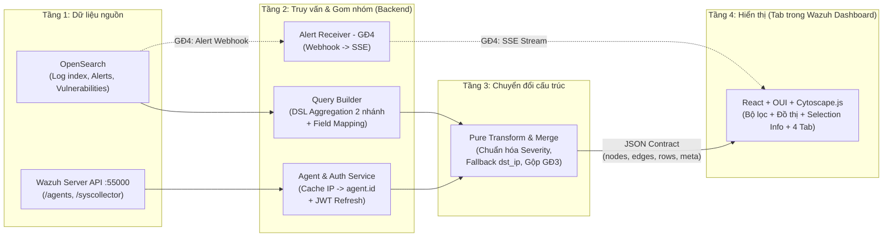
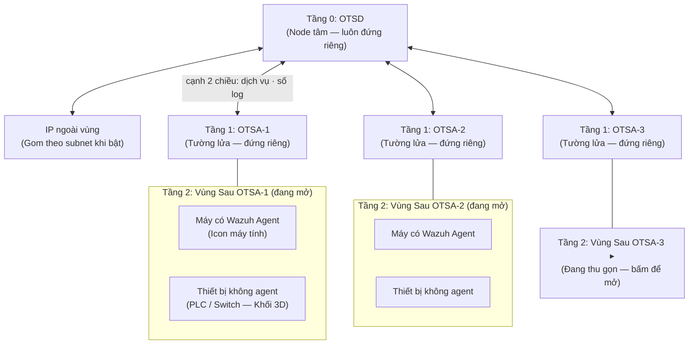

# Kế hoạch & Báo cáo Thiết kế: Công cụ Tìm kiếm và Trực quan hóa Đồ thị Kết nối (OTSD – OTSA – Wazuh)

> [!NOTE]
> **Ghi chú về dữ liệu minh họa:** Toàn bộ tên index, tên trường (`data.srcip`, `data.dstip`, `rule.level`, `action`…), địa chỉ IP (`10.0.1.10`, `10.0.2.0/24`…) và JSON ví dụ trong tài liệu này đều mang tính **minh họa** và được gắn nhãn `[CẦN ĐỐI CHIẾU LOG THỰC TẾ]`. Nhóm sẽ cập nhật theo dữ liệu thực tế ngay sau khi hoàn thành **Mục 1.1 (Khảo sát nguồn dữ liệu)**.

---

## 1. Mục tiêu, bối cảnh & kiểm tra nguồn dữ liệu

Nhóm xây dựng công cụ tìm kiếm và trực quan hóa log lưu trong **OpenSearch** của hệ thống giám sát mạng công nghiệp **OTSD – OTSA – Wazuh**. Công cụ chuyển đổi log thô thành **đồ thị kết nối có hướng** phục vụ điều tra và giám sát.

- **Vị trí trong hệ thống:** Công cụ **không thay thế** Wazuh Dashboard mà được tích hợp thành **một tab trực quan hóa** ngay trong giao diện Wazuh Dashboard (trên máy OTSD).
- **Trọng tâm điều tra:** Lấy thiết bị được tìm kiếm (mặc định là máy **OTSD**) làm trung tâm, vẽ các luồng gửi/nhận xung quanh kèm khung chi tiết và bảng dữ liệu đồng bộ.

Sau khi hoàn thành, người dùng trả lời được bốn câu hỏi nghiệp vụ cốt lõi:
1. OTSD (hoặc thiết bị đang tìm) đang kết nối với những máy nào, theo chiều nguồn → đích nào?
2. Kết nối qua dịch vụ/cổng nào, bao nhiêu bản ghi log/sự kiện, có cảnh báo hay không?
3. Mỗi thiết bị thuộc OTSA hoặc vùng mạng nào?
4. Thiết bị có cài Wazuh agent thì đang có lỗ hổng (CVE) gì và cài những phần mềm nào?

**Nguyên tắc kiểm soát phạm vi:**
- Mỗi phiên truy vấn đồ thị ở GĐ1–GĐ2 chỉ đọc từ **1 index** (tránh join chéo nặng nề).
- Khung chi tiết và các tab phụ tra cứu theo khóa `agent.id` của node đang chọn từ các nguồn cố định của Wazuh.
- Tách bạch rõ các tầng khó (lọc OTSA theo CIDR, ghép nhiều index + xử lý NAT, tự động mở đồ thị theo cảnh báo) sang các giai đoạn kế tiếp nhưng chừa sẵn khớp nối ngay từ GĐ1.

### 1.1. Kiểm tra nguồn dữ liệu thực tế (Bắt buộc làm đầu tiên)

> [!IMPORTANT]
> Kết quả khảo sát ở mục này quyết định trực tiếp tính đúng đắn của đồ thị "lưu lượng" và cách triển khai tab Lỗ hổng/Phần mềm. Phải hoàn thành trong tuần đầu trước khi chốt file cấu hình.

| Hạng mục kiểm tra | Câu hỏi cần xác minh trên hệ thống thật | Tác động nếu khác giả định |
| :--- | :--- | :--- |
| **1. Danh sách index & log mẫu** | Hệ thống có những index nào (`wazuh-alerts-*`, `wazuh-archives-*`, index tường lửa riêng…)? Xuất 5–10 dòng JSON mẫu cho từng index. | Quyết định danh sách index ở bộ lọc và nội dung file `field mapping`. |
| **2. Log tường lửa OTSA** | Log kết nối bình thường (không vi phạm rule) từ OTSA có thật sự vào OpenSearch không? Mặc định Wazuh chỉ ghi log khớp rule vào `wazuh-alerts-*`; log bình thường chỉ có khi bật `logall_json` (`wazuh-archives-*`) hoặc có pipeline riêng (Filebeat/Logstash). | Nếu không có log thường, đồ thị chỉ thể hiện **kết nối gây cảnh báo**, không phải toàn bộ lưu lượng. Cần bật pipeline/archives hoặc gắn nhãn rõ trên UI. |
| **3. Log của máy OTSD** | IP của OTSD có xuất hiện trong các index đã liệt kê không? | Nếu thiếu, đồ thị lấy OTSD làm tâm sẽ rỗng; cần cài agent kèm Sysmon (Windows) hoặc auditd (Linux) trên OTSD. |
| **4. Kiểu dữ liệu (mapping) của trường IP** | Các trường `src_ip`, `dst_ip`, `agent.ip` có kiểu `ip`, `keyword` hay `text`? Tỉ lệ bản ghi thiếu `dst_ip` (ví dụ SSH) là bao nhiêu? | Kiểu `text` không aggregation trực tiếp và không lọc CIDR được (phải dùng `.keyword` hoặc reindex/mapping lại). |
| **5. NAT trên OTSA** | OTSA có thực hiện NAT không? (So sánh IP nguồn trong log phía OTSD với dải mạng các máy phía sau OTSA). | Nếu có NAT, log phía OTSD chỉ thấy IP của OTSA; tầng `OTSA ↔ máy nội bộ` ở GĐ3 bắt buộc lấy từ log của chính OTSA. |
| **6. Phiên bản Wazuh & quyền API** | Ghi lại phiên bản Wazuh đang chạy (ví dụ 4.8+ hay cũ hơn). Thử gọi Wazuh API `/agents`, `/syscollector/{id}/packages`, `/syscollector/{id}/netiface` và kiểm tra index `wazuh-states-vulnerabilities-*`. | Phiên bản Wazuh quyết định nguồn lấy dữ liệu cho tab Lỗ hổng và Phần mềm. |

---

## 2. Phạm vi & phân chia giai đoạn

Dự án chia làm **4 giai đoạn** (GĐ1–GĐ3 hoàn thiện khung điều tra đa tầng, GĐ4 mở rộng cảnh báo gần thời gian thực). **Giai đoạn 1** là cột mốc lõi dùng để demo đầu tiên với giảng viên.

| Giai đoạn | Bộ lọc | Nguồn dữ liệu đồ thị | Chức năng chính |
| :--- | :--- | :--- | :--- |
| **GĐ1: Khung lõi** *(Demo đầu)* | **3 nấc:** Thời gian → Index → IP/User *(mặc định điền sẵn IP OTSD)*. Bộ lọc phụ: mức cảnh báo chung, dịch vụ | **1 index** | Đồ thị lấy OTSD làm tâm; 5 vùng giao diện đồng bộ; 4 tab (Kết nối, Cảnh báo, Lỗ hổng, Phần mềm); hiển thị **nhãn & khung vùng OTSA** từ file cấu hình; gom theo vùng/subnet. Thiết kế sẵn khớp nối cho GĐ2–GĐ3. |
| **GĐ2: Lọc OTSA** | **4 nấc:** Thêm nấc chọn nhánh **OTSD / OTSA** (danh sách lấy từ `zones`) | Vẫn **1 index** *(lọc theo dải CIDR)* | Chọn OTSA để lọc đồ thị và bảng theo vùng mạng tương ứng; tô viền node theo màu OTSA kèm chú thích. |
| **GĐ3: Đa index & NAT** | Cho chọn **1 index** tầng `OTSD ↔ OTSA` và **1 index** tầng `OTSA ↔ máy nội bộ` | **Nhiều index**, gộp cạnh theo khóa `src\|dst` | Vẽ đúng đường `OTSD → OTSA → máy phía sau` từ log thật; xử lý ánh xạ NAT dựa trên log của chính OTSA; bấm vào node OTSA để mở rộng (drill-down) các máy phía sau. |
| **GĐ4: Mở rộng — Cảnh báo gần thời gian thực** *(Làm sau khi vững khung cơ bản)* | Giữ nguyên + bộ lọc cảnh báo mới | Webhook từ Wazuh / OpenSearch Alerting + SSE *(hoặc WebSocket)* | Nhận alert tự động đẩy lên giao diện gần thời gian thực; hiển thị thông báo/danh sách alert mới và cho phép **mở nhanh hoặc tự động vẽ đồ thị** lấy thiết bị gây cảnh báo làm tâm. |

**Ngoài phạm vi dự án:**
- Trường **CWE** như mẫu giao diện tham khảo *(Wazuh không lưu CWE; thay bằng tên gói phần mềm bị lỗi và phiên bản)*.
- Gom nhóm **IPv6** *(nếu log có IPv6 thì vẽ thành node riêng, không gom subnet)*.
- Thao tác **ghi hoặc sửa dữ liệu** trong Wazuh / OpenSearch *(công cụ chỉ có quyền đọc)*.
- *Tùy chọn (làm nếu còn thời gian):* Tra cứu tên hãng sản xuất theo địa chỉ MAC (bảng OUI).

> [!TIP]
> Trước buổi demo đầu tiên, nhóm cần thống nhất rõ với giảng viên: **GĐ1 đã có nhãn/vùng OTSA** nhưng nấc lọc OTSA nằm ở GĐ2, xử lý đa index/NAT nằm ở GĐ3, và tính năng nhận cảnh báo tự động vẽ đồ thị (Alert-driven Graph) triển khai ở GĐ4 sau khi khung cơ bản chạy ổn định.

---

## 3. Kiến trúc tổng thể, so sánh phương án & tích hợp tab Wazuh Dashboard

### 3.1. Kiến trúc pipeline 4 tầng



**Khớp nối thiết kế sẵn từ GĐ1 để mở rộng không phải đập đi làm lại:**
1. **API nhận mảng index (`indices: string[]`):** GĐ1 truyền mảng 1 phần tử; GĐ3 truyền nhiều index (hoặc gọi thêm endpoint `POST /api/graph/expand` cho node OTSA).
2. **Hợp đồng JSON có sẵn trường mở rộng:** Node có sẵn `tier`, `parent`, `expandable`; Edge có sẵn `sources` (danh sách index đóng góp cạnh đó).
3. **Tách hàm `transform` thuần (pure function):** Tách bước *truy vấn 1 index* và bước *chuẩn hóa + gộp (merge)*. Khi lên GĐ3 chỉ cần chạy `transform` cho từng index rồi hợp nhất theo khóa `src|dst`.

### 3.2. So sánh và lựa chọn công nghệ

| Phương án | Ưu điểm | Nhược điểm | Kết luận |
| :--- | :--- | :--- | :--- |
| **Công cụ có sẵn** *(Grafana Node Graph, OpenSearch Dashboards Graph)* | Cài đặt nhanh, ít viết code. | Khó tùy biến giao diện 5 vùng đồng bộ theo mẫu thầy; khó xử lý fallback `dst_ip`, gom vùng OTSA động, hay tra cứu chéo Wazuh API (`/agents`, `/syscollector`). | **Không chọn** |
| **Plotly Dash / Streamlit** *(Python thuần)* | Dựng prototype rất nhanh, 1 ngôn ngữ. | Khó gắn mượt thành tab trong Wazuh Dashboard; hạn chế tương tác đồ thị nâng cao (compound node mở/thu gọn, tô sáng 2 chiều mượt); bất lợi cho đẩy luồng SSE (GĐ4) và chia việc nhóm FE/BE. | **Không chọn** |
| **React + Cytoscape.js + OUI + Backend tách lớp** *(OSD Plugin hoặc FastAPI)* | Tách biệt rõ 2 mảng FE/BE để làm song song; giao diện đồng bộ phong cách OUI với Wazuh Dashboard; Cytoscape hỗ trợ mạnh compound node & thuật toán đồ thị; sẵn sàng cho SSE/WebSocket ở GĐ4. | Chi phí khởi tạo dự án và cấu hình ban đầu cao hơn Dash/Streamlit. | **Chọn** |

### 3.3. Phương án tích hợp thành 1 tab trong Wazuh Dashboard (trên OTSD)

Vì thầy yêu cầu công cụ là **một tab trực tiếp trên giao diện Wazuh Dashboard (chạy trên máy OTSD)**, về mặt kỹ thuật cần đăng ký ứng dụng vào **OpenSearch Dashboards (OSD)**. Có hai phương án triển khai để nhóm kiểm thử và chốt trong tuần đầu:

| Tiêu chí | Phương án A: OSD Plugin gốc *(Native Plugin)* | Phương án B: Thin Plugin + iframe *(sau Reverse Proxy)* |
| :--- | :--- | :--- |
| **Cách hoạt động** | Viết 1 plugin OpenSearch Dashboards chuẩn: `public/` dùng React + OUI + Cytoscape.js; `server/` (TypeScript/Node.js) gọi thẳng OpenSearch client nội bộ của OSD + gọi Wazuh API. | Tạo 1 plugin vỏ mỏng chỉ đăng ký tab trên menu Wazuh Dashboard và nhúng `iframe` trỏ về web app **React + FastAPI (`opensearch-py`)** qua Reverse Proxy (Nginx). |
| **Ưu điểm** | Trải nghiệm liền mạch nhất; dùng sẵn xác thực phiên đăng nhập và giao diện OUI của Wazuh Dashboard; không cần vận hành thêm dịch vụ riêng. | Tách hoàn toàn quy trình build khỏi hệ thống nặng của OSD (tránh lỗi R10); viết backend bằng Python/FastAPI quen thuộc; triển khai SSE ở GĐ4 rất gọn. |
| **Nhược điểm** | Môi trường build OSD nặng, nhạy cảm với đúng phiên bản Wazuh Dashboard; backend bắt buộc viết TypeScript (trừ khi proxy sang FastAPI). | Phải cấu hình Reverse Proxy (CORS, CSP `frame-ancestors`), truyền/đồng bộ phiên xác thực riêng giữa Dashboard và web app. |
| **Đề xuất** | **Ưu tiên thử build mẫu trong tuần 1 (mục R10).** Nếu build Cytoscape ổn định và nhóm nắm được TypeScript → chốt Phương án A. | **Phương án dự phòng chính thức** (hoặc chọn ngay nếu nhóm chốt dùng Python FastAPI cho backend ở GĐ1). |

---

## 4. Mô hình mạng, quy ước đồ thị & bố cục giao diện

### 4.1. Mô hình mạng 3 tầng

Đồ thị luôn lấy **OTSD** (hoặc thiết bị đang tìm) làm tâm. Các tường lửa **OTSA** nằm ở tầng 1 (đứng độc lập làm nút trung gian, **không bị gộp vào khung Vùng OTSD**). Các thiết bị phía sau từng OTSA nằm trong khung bao (compound node) khai báo trong file `zones`. Trên giao diện thật, các node xếp vòng quanh tâm (bố cục `concentric`); sơ đồ dưới trình bày dạng cây để dễ theo dõi cấu trúc tầng:



> [!NOTE]
> Ở **GĐ1**, nhãn OTSA và khung vùng được gán từ file cấu hình `zones`, chưa đọc từ log tường lửa. Do đó các cạnh luôn phản ánh đúng những gì index đang chọn ghi nhận được (xem thêm **R7** về NAT).

### 4.2. Quy ước hiển thị Node và Cạnh

| Thành phần | Hình vẽ | Ghi chú |
| :--- | :--- | :--- |
| **OTSD** | Icon máy chủ, viền đậm, đặt ở giữa | Node tâm mặc định, không bao giờ bị gom vào nhóm. |
| **OTSA** | Icon tường lửa, nhãn là tên OTSA | Danh sách nhận diện theo `otsaIp` trong `zones`; **đứng riêng**, không bị gom vào vùng OTSD. |
| **Máy có Wazuh agent** | Icon máy tính | Bấm vào xem được OS, MAC, lỗ hổng (CVE), phần mềm. |
| **Máy không có agent** | Khối lập phương 3D | PLC, switch, thiết bị lạ; tab Lỗ hổng/Phần mềm hiển thị *"Không có agent"*. |
| **User** *(khi tìm theo User)* | Icon người | Làm node tâm, nối tới các IP mà user đó có log đăng nhập/tác động. |
| **Vùng / Nhóm subnet** | Khung bao *(compound node)* | Khi thu gọn hiển thị thành 1 node kèm ký hiệu `▸`. |

**Quy ước màu sắc (tách bạch giữa Mức cảnh báo và Trạng thái đang chọn):**
- **Màu theo mức cảnh báo cao nhất của node** *(dùng thang chung ở Mục 5.3)*:
  - **Xanh dương nhạt / Xám nhạt:** Bình thường / mức Thấp.
  - **Vàng:** Mức Trung bình.
  - **Cam:** Mức Cao.
  - **Đỏ:** Mức Nghiêm trọng.
  - **Xám (viền nét đứt):** Agent đã ngắt kết nối hoặc không có log trong khoảng thời gian chọn.
- **Trạng thái đang chọn (Selected):** Không dùng chung màu với trạng thái bình thường. Khi bấm chọn một node/cạnh, áp dụng **viền sáng đậm (halo)** cho đối tượng được chọn cùng các node lân cận, đồng thời **làm mờ (giảm opacity)** phần còn lại của đồ thị (tương tự demo *Wine & cheese* của Cytoscape).

**Quy ước cạnh:**
- Luôn dùng `curve-style: bezier` *(tránh `haystack` vì làm mất mũi tên chỉ hướng)*.
- Kết nối hai chiều vẽ thành **hai cạnh cong tách biệt** theo chiều `nguồn → đích`.
- Nhãn cạnh hiển thị dịch vụ và **số log** (ví dụ: `vnc · 120` hoặc `ssh, smb, +2 · 450`).
- Độ dày cạnh tỉ lệ (theo thang logarit) với số log; màu cạnh theo mức cảnh báo cao nhất trên cạnh đó.

### 4.3. Bố cục giao diện 5 vùng & tương tác đồng bộ

Giao diện bám sát mẫu giảng viên cung cấp, gồm 5 vùng:
1. **Thanh lọc (trên cùng):** GĐ1 gồm 3 nấc (`Thời gian → Index → IP/User`, mặc định điền IP OTSD) + bộ lọc phụ (`Mức cảnh báo`, `Dịch vụ`, `Gom subnet /16 /24 /28`). GĐ2 thêm nấc `OTSD/OTSA`.
2. **Dòng `Details for <IP / Tên máy tâm>`:** Hiển thị nhanh OS, IP, MAC, OTSA/vùng, trạng thái agent của node đang làm tâm.
3. **Vùng Đồ thị Cytoscape (bên trái):** Bấm node → xem chi tiết & lọc bảng; bấm đúp node → đặt làm tâm mới và tải lại đồ thị; bấm khung vùng/nhóm → mở rộng hoặc thu gọn; rê chuột → hiện tooltip.
4. **Khung `Selection info` (bên phải):**
   - *Khi chọn Node:* IP, tên agent, OS, MAC, OTSA/vùng, số log gửi/nhận, số kết nối, mức cảnh báo cao nhất, lần thấy gần nhất.
   - *Khi chọn Cạnh:* Chi tiết luồng một chiều (`src → dst`), danh sách dịch vụ/cổng, số log, mức cao nhất.
   - *Khi chọn Nhóm/Vùng:* Số lượng máy trong nhóm, tổng số log, mức cảnh báo cao nhất.
5. **Bảng tổng quan 4 tab (bên dưới):** Hỗ trợ phân trang, sắp xếp, lọc cột, **xuất CSV**, đồng bộ click hai chiều với đồ thị (bấm dòng trong bảng → tô sáng cạnh tương ứng trên đồ thị).

| Tab | Cột chính | Nguồn dữ liệu | Phạm vi thời gian |
| :--- | :--- | :--- | :--- |
| **Kết nối** | IP nguồn, IP đích, dịch vụ/cổng, số log, mức cao nhất, lần thấy cuối | Index đang chọn ở nấc 2 | **Theo thanh lọc Thời gian** |
| **Cảnh báo** | Thời gian, Rule ID, mô tả, mức cảnh báo (`rule.level`) | `wazuh-alerts-*` lọc theo `agent.id` hoặc IP | **Theo thanh lọc Thời gian** |
| **Lỗ hổng** | CVE, điểm CVSS, mức độ, gói phần mềm, phiên bản, ngày phát hiện | `wazuh-states-vulnerabilities-*` | **Trạng thái hiện tại** *(không theo thanh thời gian)* |
| **Phần mềm** | Tên gói, phiên bản, nhà phát hành, ngày cài đặt | `/syscollector/{agent_id}/packages` hoặc `wazuh-states-inventory-*` | **Trạng thái hiện tại** *(không theo thanh thời gian)* |

**Ánh xạ các trường thay thế so với mẫu tham khảo (do Wazuh không có sẵn):**
- `roles`, `is learned` → thay bằng **nhóm agent (`group`)** và **trạng thái agent (`status`)**.
- `zone` → thay bằng **tên OTSA / tên vùng** từ file cấu hình `zones`.
- `CWE` → thay bằng **gói phần mềm bị lỗi và phiên bản**.

---

## 5. Nguồn dữ liệu, file cấu hình & thang cảnh báo chung

### 5.1. Bảng ánh xạ nguồn dữ liệu trong Wazuh

| Thông tin | Nguồn trong Wazuh | Ghi chú kỹ thuật |
| :--- | :--- | :--- |
| Đồ thị & tab Kết nối | Index log người dùng chọn | GĐ1–GĐ2: 1 index; GĐ3: tối đa 2 index |
| Tên máy, OS, IP, trạng thái, nhóm | Wazuh Server API `GET /agents` | Cache bảng `IP → agent.id` (TTL 5–10 phút). *Lưu ý:* máy nhiều card mạng chỉ khớp mặc định theo IP đăng ký chính; có thể bổ sung tra `/syscollector/{id}/netaddr` nếu cần. |
| MAC, card mạng | `GET /syscollector/{agent_id}/netiface` | Chỉ gọi khi người dùng chọn node cụ thể (lazy load). |
| Tab Phần mềm | `GET /syscollector/{agent_id}/packages` hoặc `wazuh-states-inventory-*` | Tùy phiên bản Wazuh xác định ở Mục 1.1. |
| Tab Lỗ hổng | Index `wazuh-states-vulnerabilities-*` | Áp dụng cho Wazuh 4.8 trở lên. |
| Tab Cảnh báo | Index `wazuh-alerts-*` | Tra theo `agent.id` hoặc IP; không vẽ trực tiếp lên đồ thị nếu đang xem index khác. |

### 5.2. File cấu hình hệ thống mẫu `[CẦN ĐỐI CHIẾU LOG THỰC TẾ]`

Toàn bộ tham số cấu hình đặt tập trung trong một file JSON (backend nạp lúc khởi động và kiểm tra hợp lệ CIDR chồng lấn):

```json
{
  "otsd": {
    "ip": "10.0.1.10",
    "name": "OTSD"
  },
  "zones": [
    { "cidr": "10.0.1.0/26", "name": "Vùng OTSD" },
    { "cidr": "10.0.2.0/24", "name": "Sau OTSA-1", "otsa": "OTSA-1", "otsaIp": "10.0.1.21" },
    { "cidr": "10.0.3.0/24", "name": "Sau OTSA-2", "otsa": "OTSA-2", "otsaIp": "10.0.1.22" }
  ],
  "defaults": {
    "timeRange": "24h",
    "timeZone": "+07:00",
    "topN": 50,
    "groupingThreshold": 25,
    "groupingTopN": 500,
    "queryTimeoutSec": 10
  },
  "ports": {
    "22": "ssh", "80": "web", "443": "web", "445": "smb",
    "3389": "rdp", "5900": "vnc", "502": "modbus", "102": "s7"
  },
  "edgeSeverityRules": {
    "repeatDenyThreshold": 20,
    "otPorts": [502, 102]
  },
  "indices": {
    "wazuh-alerts-*": {
      "timestamp": "timestamp",
      "srcIp": "data.srcip",
      "dstIp": "data.dstip",
      "dstIpFallback": "agent.ip",
      "dstPort": "data.dstport",
      "username": "data.dstuser",
      "agentName": "agent.name",
      "agentId": "agent.id",
      "severityMode": "numeric_level",
      "levelField": "rule.level",
      "packetsField": null,
      "bytesField": null
    },
    "otsa-firewall-*": {
      "timestamp": "@timestamp",
      "srcIp": "source.ip",
      "dstIp": "destination.ip",
      "dstIpFallback": "agent.ip",
      "dstPort": "destination.port",
      "username": "user.name",
      "agentName": "host.name",
      "agentId": "agent.id",
      "severityMode": "firewall_action",
      "actionField": "event.action",
      "packetsField": "source.packets",
      "bytesField": "network.bytes"
    }
  }
}
```

**Quy tắc bắt buộc khi ánh xạ trường:**
1. **Xử lý thiếu `dstIp`:** Các log như SSH hoặc nhiều alert host-based chỉ có IP nguồn và không có `dstIp`. Bắt buộc fallback sang `dstIpFallback` (thường là `agent.ip`) ở cả tầng lọc lẫn nhánh aggregation tách riêng (`no_dst`), đồng thời yêu cầu tồn tại `srcIp` để không kéo nhầm các alert không liên quan mạng (syscheck, rootcheck, SCA).
2. **Kiểu trường IP:** Cần kiểu `ip` (để lọc CIDR ở GĐ2) hoặc `keyword` (để aggregation). Nếu khảo sát ở Mục 1.1 phát hiện trường là kiểu `text`, phải khai báo rõ hậu tố `.keyword` trong file ánh xạ.
3. **Phân biệt "số log" và "số gói":** `doc_count` của OpenSearch là **số bản ghi log/sự kiện** — tuyệt đối không ghi nhãn là "số gói". Chỉ khi index tường lửa có trường gói/byte thật (như `sentpkt`, `rcvdbyte`) mới khai báo `packetsField`/`bytesField` để tính tổng bằng aggregation `sum`.

### 5.3. Thang cảnh báo chung

Để màu sắc và bộ lọc mức cảnh báo nhất quán giữa các index, hệ thống quy đổi về 4 mức chuẩn và **tách rõ hai cấp đánh giá**:
- **Cấp bản ghi (khi lọc/truy vấn OpenSearch):** Chỉ dựa trên giá trị có sẵn trong từng dòng log (`rule.level`, `event.action`, `dstPort`).
- **Cấp cạnh sau tổng hợp (tại tầng `transform`):** Các quy tắc cần đếm tần suất (như *`deny` lặp lại vượt ngưỡng*) **không quy đổi được trên từng bản ghi** mà được tính sau khi OpenSearch đã aggregation đếm số lượng `deny`/`drop` trên từng cạnh.

| Mức chuẩn (`severity`) | Wazuh `rule.level` *(cấp bản ghi)* | Log tường lửa — cấp bản ghi *(đề xuất)* | Quy tắc nâng mức ở cấp cạnh sau tổng hợp *(tầng `transform`)* | Màu hiển thị |
| :--- | :--- | :--- | :--- | :--- |
| `low` (Thấp) | `0 – 6` | `allow` | — | Xanh dương nhạt / Xám nhạt |
| `medium` (Trung bình) | `7 – 11` | `deny`, `drop` | — | Vàng |
| `high` (Cao) | `12 – 14` | `deny`/`drop` vào cổng OT (`502`, `102`) | Tổng số log `deny`/`drop` trên cạnh ≥ `repeatDenyThreshold` *(mặc định `20`, cấu hình trong `edgeSeverityRules`)* | Cam |
| `critical` (Nghiêm trọng) | `15` | *(Nhóm chốt theo rule tường lửa thực tế)* | *(Nhóm chốt nếu có ngưỡng cực đoan)* | Đỏ |

---

## 6. Truy vấn OpenSearch mẫu & hợp đồng dữ liệu JSON

### 6.1. Truy vấn Aggregation mẫu cho GĐ1 (2 nhánh ngang cấp + nhánh tách riêng `no_dst`) `[CẦN ĐỐI CHIẾU LOG THỰC TẾ]`

> [!IMPORTANT]
> **Các nguyên tắc kỹ thuật bắt buộc trong truy vấn GĐ1:**
> 1. **Không dùng `missing: "__MISSING_DST__"` trên trường `dstIp`:** Nếu `data.dstip` có kiểu `ip`, OpenSearch sẽ báo lỗi kiểu dữ liệu; đồng thời nếu đặt `ports`/`maxLevel`/`latest` ở cấp bucket `missing` chung thì mọi cạnh fallback sẽ bị gán nhầm cùng một bộ cổng và mức cảnh báo. Thay vào đó, **tách nhánh `no_dst` riêng** và đặt các sub-aggregation bên dưới `agent.ip`.
> 2. **Bắt buộc `exists: data.srcip` ở mệnh đề fallback và nhánh `inbound`:** Loại bỏ hoàn toàn các alert nội bộ không liên quan đến mạng (như `syscheck`, `rootcheck`, `SCA`) do agent OTSD tự sinh nhưng không có `srcip`, tránh làm lệch tổng số log khi đối chiếu với Discover.
> 3. **Loại cạnh tự nối (`src === dst`):** Nhánh `no_dst` loại sẵn `agent.ip == tâm`, và tầng `transform` luôn lọc bỏ mọi cạnh có `src === dst`.
> 4. **Định nghĩa nhất quán cho `topN`:** `topN` (mặc định `50`, hoặc `500` khi bật gom) là **tổng số cạnh tối đa hiển thị trên toàn đồ thị** (không phải riêng mỗi nhánh). Backend lấy dư ở từng nhánh (`size: topN`), sau đó `transform` gộp các cạnh trùng khóa `src|dst`, loại self-loop rồi **cắt lấy đúng `topN` cạnh đứng đầu** theo thứ tự ưu tiên **mức cảnh báo giảm dần → số log giảm dần**. Số log của các cạnh bị cắt được cộng dồn vào `meta.otherLogs` cùng với `sum_other_doc_count` từ OpenSearch.

Ví dụ truy vấn tìm các kết nối quanh OTSD (`10.0.1.10`) trên index `wazuh-alerts-*` trong 24 giờ qua *(điều kiện lọc mức cảnh báo sinh động theo `severityMode` trong file cấu hình; với index tường lửa, thêm sub-agg `actions: { terms: { field: "event.action", size: 10 } }` trong từng bucket cạnh để tầng `transform` đếm số lần `deny`/`drop` cho quy tắc nâng mức ở Mục 5.3)*:

```json
{
  "size": 0,
  "timeout": "10s",
  "query": {
    "bool": {
      "filter": [
        { "range": { "timestamp": { "gte": "now-24h", "time_zone": "+07:00" } } },
        { "range": { "rule.level": { "gte": 7 } } },
        {
          "bool": {
            "should": [
              { "term": { "data.srcip": "10.0.1.10" } },
              {
                "bool": {
                  "filter": [
                    { "exists": { "field": "data.srcip" } },
                    { "term": { "data.dstip": "10.0.1.10" } }
                  ]
                }
              },
              {
                "bool": {
                  "must_not": [{ "exists": { "field": "data.dstip" } }],
                  "filter": [
                    { "exists": { "field": "data.srcip" } },
                    { "term": { "agent.ip": "10.0.1.10" } }
                  ]
                }
              }
            ],
            "minimum_should_match": 1
          }
        }
      ]
    }
  },
  "aggs": {
    "outbound": {
      "filter": { "term": { "data.srcip": "10.0.1.10" } },
      "aggs": {
        "total_peers": { "cardinality": { "field": "data.dstip" } },
        "peers": {
          "terms": { "field": "data.dstip", "size": 50 },
          "aggs": {
            "ports": { "terms": { "field": "data.dstport", "size": 5 } },
            "maxLevel": { "max": { "field": "rule.level" } },
            "latest": {
              "top_hits": {
                "size": 1,
                "sort": [{ "timestamp": "desc" }],
                "_source": ["agent.name", "agent.id", "agent.ip", "timestamp"]
              }
            }
          }
        },
        "no_dst": {
          "filter": {
            "bool": {
              "must_not": [
                { "exists": { "field": "data.dstip" } },
                { "term": { "agent.ip": "10.0.1.10" } }
              ]
            }
          },
          "aggs": {
            "total_peers": { "cardinality": { "field": "agent.ip" } },
            "by_agent": {
              "terms": { "field": "agent.ip", "size": 50 },
              "aggs": {
                "ports": { "terms": { "field": "data.dstport", "size": 5 } },
                "maxLevel": { "max": { "field": "rule.level" } },
                "latest": {
                  "top_hits": {
                    "size": 1,
                    "sort": [{ "timestamp": "desc" }],
                    "_source": ["agent.name", "agent.id", "agent.ip", "timestamp"]
                  }
                }
              }
            }
          }
        }
      }
    },
    "inbound": {
      "filter": {
        "bool": {
          "filter": [{ "exists": { "field": "data.srcip" } }],
          "should": [
            { "term": { "data.dstip": "10.0.1.10" } },
            {
              "bool": {
                "must_not": [{ "exists": { "field": "data.dstip" } }],
                "filter": [{ "term": { "agent.ip": "10.0.1.10" } }]
              }
            }
          ],
          "minimum_should_match": 1
        }
      },
      "aggs": {
        "total_peers": { "cardinality": { "field": "data.srcip" } },
        "peers": {
          "terms": { "field": "data.srcip", "size": 50 },
          "aggs": {
            "ports": { "terms": { "field": "data.dstport", "size": 5 } },
            "maxLevel": { "max": { "field": "rule.level" } },
            "latest": {
              "top_hits": {
                "size": 1,
                "sort": [{ "timestamp": "desc" }],
                "_source": ["agent.name", "agent.id", "agent.ip", "timestamp"]
              }
            }
          }
        }
      }
    }
  }
}
```

**Các quy tắc bắt buộc khi dựng truy vấn và xử lý ở Backend:**
- **Luôn có `"minimum_should_match": 1`:** Trong một khối `bool` đã có `filter`, nếu thiếu dòng này thì `should` trở thành tùy chọn và truy vấn trả về toàn bộ log.
- **Gộp nhánh `outbound.peers` + `outbound.no_dst.by_agent` và cắt `topN` toàn cục:** Nếu cùng một IP đích xuất hiện ở cả hai nhánh, `transform` cộng dồn `count`, hợp `ports`, lấy `maxLevel` và `latest` mới nhất; loại bỏ mọi cạnh `src === dst`; sau đó cắt giữ tối đa `topN` cạnh cho toàn bộ đồ thị.
- **Tính `meta.otherLogs` và `meta.truncated`:** Cộng `sum_other_doc_count` của `outbound.peers`, `outbound.no_dst.by_agent`, `inbound.peers` với tổng `count` của các cạnh bị cắt ngoài `topN` tại `transform`. Nếu `otherLogs > 0` hoặc tổng cạnh trước khi cắt vượt `topN` thì đặt `truncated = true`.
- **Truy vấn theo User (GĐ1) và theo dải CIDR OTSA (GĐ2):** Thay mệnh đề lọc IP tâm bằng `term` trên `username` (hoặc `should` theo CIDR trên `srcIp`/`dstIp` kèm `minimum_should_match: 1` và `exists` trên `srcIp`), và dùng aggregation **`multi_terms`** của OpenSearch trên cặp `[srcIp, dstIp]` với `size: topN`.
- **Múi giờ:** Truyền `time_zone` khớp tuyệt đối với cấu hình Wazuh Discover để số liệu khớp khi đối chiếu.

### 6.2. Hợp đồng JSON giữa Backend và Frontend `[MINH HỌA]`

Hai mảng Dữ liệu (A) và Giao diện (B) chốt hợp đồng này ở **Mục 1.3** để chạy song song. **Toàn bộ khóa JSON sử dụng thống nhất chuẩn `camelCase`** (không trộn `snake_case`) và tên mảng bảng thống nhất là **`rows`**.

**Quy ước tiền tố định danh (`id`) bắt buộc để không trùng lặp giữa các loại node:**

| Loại đối tượng | Quy ước `id` | Ví dụ |
| :--- | :--- | :--- |
| Thiết bị *(OTSD, OTSA, máy có/không có agent)* | Địa chỉ IP chuẩn | `"10.0.1.10"` |
| User *(khi tìm theo User)* | Tiền tố `user:` | `"user:admin"` |
| Vùng mạng *(khai báo trong `zones`)* | Tiền tố `zone:` | `"zone:Sau OTSA-1"` |
| Nhóm subnet *(khi bật gom)* | Tiền tố `net:` | `"net:10.0.2.0/24"` |
| Cạnh có hướng | `"${source}\|${target}"` | `"10.0.1.10\|10.0.1.21"`, `"user:admin\|10.0.1.10"` |

**Request (`POST /api/graph/query`):**
```json
{
  "indices": ["wazuh-alerts-*"],
  "timeRange": { "from": "now-24h", "to": "now", "timeZone": "+07:00" },
  "target": { "type": "ip", "value": "10.0.1.10" },
  "filters": {
    "otsa": null,
    "minSeverity": "medium",
    "service": null
  },
  "topN": 50
}
```

**Response (`200 OK`):**
```json
{
  "meta": {
    "indices": ["wazuh-alerts-*"],
    "centerId": "10.0.1.10",
    "topN": 50,
    "truncated": true,
    "otherLogs": 142,
    "shownPairs": 50,
    "totalPairs": 84,
    "queryTimeMs": 215
  },
  "nodes": [
    {
      "id": "10.0.1.10",
      "label": "OTSD",
      "kind": "otsd",
      "ip": "10.0.1.10",
      "tier": 0,
      "otsa": null,
      "zone": "Vùng OTSD",
      "parent": null,
      "expandable": false,
      "agentId": "001",
      "hasAgent": true,
      "logsOut": 340,
      "logsIn": 120,
      "maxLevel": 10,
      "severity": "medium",
      "lastSeen": "2026-11-26T14:20:00+07:00"
    },
    {
      "id": "10.0.1.21",
      "label": "OTSA-1",
      "kind": "otsa",
      "ip": "10.0.1.21",
      "tier": 1,
      "otsa": "OTSA-1",
      "zone": null,
      "parent": null,
      "expandable": false,
      "agentId": null,
      "hasAgent": false,
      "logsOut": 80,
      "logsIn": 210,
      "maxLevel": 12,
      "severity": "high",
      "lastSeen": "2026-11-26T14:19:45+07:00"
    }
  ],
  "edges": [
    {
      "id": "10.0.1.10|10.0.1.21",
      "source": "10.0.1.10",
      "target": "10.0.1.21",
      "services": ["ssh", "modbus"],
      "count": 210,
      "packets": null,
      "bytes": null,
      "maxLevel": 12,
      "severity": "high",
      "lastSeen": "2026-11-26T14:19:45+07:00",
      "sources": ["wazuh-alerts-*"]
    }
  ],
  "rows": [
    {
      "edgeId": "10.0.1.10|10.0.1.21",
      "src": "10.0.1.10",
      "dst": "10.0.1.21",
      "services": ["ssh", "modbus"],
      "count": 210,
      "maxLevel": 12,
      "severity": "high",
      "lastSeen": "2026-11-26T14:19:45+07:00",
      "otsaSrc": null,
      "otsaDst": "OTSA-1"
    }
  ]
}
```

> Khi sang **GĐ3**, tầng `transform` chạy cho từng index trong `indices`, sau đó gộp các cạnh có cùng `id` (`src|dst`): cộng dồn `count`, lấy `maxLevel`/`severity` cao nhất, hợp nhất `services` và `sources`.

---

## 7. Quy tắc gom nhóm vùng / subnet & thư viện Cytoscape.js

### 7.1. Quy tắc gom nhóm

**Mặc định không gom subnet** để hiển thị rõ từng thiết bị. Tuy nhiên, các vùng đã khai báo trong `zones` luôn được vẽ **khung bao ở trạng thái mở** để người dùng nhận diện nhanh máy thuộc OTSA/vùng nào.

- **Ngưỡng gợi ý gom:** Khi số node trên đồ thị lớn hơn `groupingThreshold` (mặc định **25**, nhỏ hơn `topN = 50` để nút gợi ý thực sự kích hoạt được), giao diện hiện nút **"Gom theo subnet"** (gợi ý `/24`).
- **Tách rõ 2 hành động truy vấn:**
  - **Khi bật chế độ Gom subnet:** Gọi lại API backend **1 lần** với `topN = groupingTopN` (ví dụ `500`) để tổng số log của từng nhóm phản ánh sát thực tế; phần vượt quá hiển thị *"Còn X log khác"*.
  - **Khi đổi độ dài prefix (`/16`, `/24`, `/28`) trong lúc đang bật gom:** Chỉ tính lại nhóm và gộp cạnh từ dữ liệu đã có trong bộ nhớ, **không truy vấn lại OpenSearch**.
- **Thứ tự ưu tiên xác định nhóm của một địa chỉ (khớp điều kiện nào dừng ngay ở đó):**
  1. Không phải IPv4 hợp lệ *(ví dụ IPv6, node User, chuỗi rỗng)* → **đứng riêng** (`null`).
  2. Là node tâm (`centerIp`) → **luôn đứng riêng**, không gán `parent`.
  3. Là IP của một tường lửa OTSA (`otsaIps`) → **đứng riêng ở tầng 1**, không bị nhét vào khung `Vùng OTSD`.
  4. Khớp một vùng trong `zones` → thuộc vùng đó *(nếu khớp nhiều vùng thì chọn vùng có prefix dài nhất — longest prefix match)*.
  5. Đang bật gom subnet → gom theo prefix đang chọn (`/16`, `/24`, `/28`).
  6. Còn lại → vẽ thành thiết bị riêng lẻ.

**Hàm `groupOf` chuẩn hóa (đã bổ sung guard IPv4 và loại trừ `otsaIps`):**

```javascript
const IPV4_REGEX = /^(25[0-5]|2[0-4]\d|1\d\d|[1-9]?\d)(\.(25[0-5]|2[0-4]\d|1\d\d|[1-9]?\d)){3}$/;

const isIPv4 = (ip) => typeof ip === 'string' && IPV4_REGEX.test(ip);
const ipToInt = (ip) => ip.split('.').reduce((a, o) => (a << 8) + Number(o), 0) >>> 0;
const maskOf = (bits) => (bits === 0 ? 0 : (~0 << (32 - bits)) >>> 0);

const inCidr = (ip, cidr) => {
  if (!isIPv4(ip)) return false;
  const [net, b] = cidr.split('/');
  if (!isIPv4(net)) return false;
  const m = maskOf(Number(b));
  return (ipToInt(ip) & m) === (ipToInt(net) & m);
};

const prefixOf = (ip, bits) => {
  const n = ipToInt(ip) & maskOf(bits);
  return `${[24, 16, 8, 0].map((s) => (n >>> s) & 255).join('.')}/${bits}`;
};

// Trả về { id, label } của nhóm, hoặc null nếu vẽ riêng
function groupOf(ip, { centerIp, otsaIps = new Set(), zones = [], grouping = false, prefix = 24 }) {
  if (!isIPv4(ip)) return null;
  if (ip === centerIp) return null;
  if (otsaIps.has(ip)) return null;

  const zone = zones
    .filter((z) => inCidr(ip, z.cidr))
    .sort((a, b) => Number(b.cidr.split('/')[1]) - Number(a.cidr.split('/')[1]))[0];
  if (zone) return { id: `zone:${zone.name}`, label: zone.name };

  if (grouping) {
    const p = prefixOf(ip, prefix);
    return { id: `net:${p}`, label: p };
  }
  return null;
}
```

### 7.2. Thư viện Cytoscape.js & các extension sử dụng

| Thành phần | Mục đích | Bắt buộc? |
| :--- | :--- | :--- |
| `cytoscape` | Lõi vẽ đồ thị, stylesheet dạng CSS, xử lý sự kiện click/double-click | Có |
| Layout `concentric` *(tích hợp sẵn)* | Bố cục mặc định: node tâm ở giữa, các tầng khác xếp đồng tâm xung quanh | Có |
| `cytoscape-fcose` | Bố cục khi mở rộng nhóm; ghim được vị trí các node hiện có để tránh nhảy đồ thị | Có |
| `cytoscape-expand-collapse` | Thu gọn / mở rộng compound node; tự động gộp và tách cạnh | Có |
| `cytoscape-popper` + `tippy.js` | Tooltip hiển thị nhanh thông tin khi rê chuột lên node/cạnh | Nên có |
| `cytoscape-cxtmenu` | Menu chuột phải (mở/thu gọn, đặt làm tâm, mở log gốc trong Discover) | Tùy chọn |

- **Không sử dụng:** `Edgehandles`, `Automove`, `Compound drag-and-drop` (cho sửa đồ thị, không cần thiết); `CoSE`/`CoSE Bilkent` (cũ hơn `fcose`); `CiSE`, `AVSDF`, `Circle`, `Grid` (không đặt được 1 node làm trung tâm).
- **Mã nguồn mẫu nên tham khảo:** Demo *Wine & cheese* trên `js.cytoscape.org` (có sẵn ô tìm kiếm, làm mờ phần không liên quan khi chọn node, và panel chi tiết bên cạnh).

---

## 8. Yêu cầu phi chức năng (Bảo mật, Hiệu năng, Triển khai)

### 8.1. Bảo mật
- **Tài khoản chỉ đọc (Read-only):** Mọi truy vấn OpenSearch chạy từ backend (hoặc `server/` của plugin) bằng tài khoản chỉ có quyền `read` trên các index được khai báo. Tuyệt đối không gửi thông tin xác thực OpenSearch hoặc Wazuh API xuống trình duyệt.
- **Quản lý xác thực 2 hệ thống:** OpenSearch (cổng `9200`) dùng Basic Auth / client nội bộ OSD; Wazuh Server API (cổng `55000`) dùng **JWT token có thời hạn 15 phút (900 giây)** — backend bắt buộc có cơ chế tự động xin cấp lại token khi hết hạn hoặc gặp mã `401`.
- **Kiểm soát đầu vào:** Tên index chỉ được phép chọn từ danh sách whitelist trong file cấu hình; kiểm tra định dạng IP/CIDR/thời gian ở backend trước khi lắp vào Query DSL.

### 8.2. Hiệu năng
- **Không tải log thô:** Mọi truy vấn đồ thị dùng `size: 0` (chỉ nhận kết quả aggregation) và giới hạn mặc định 24 giờ gần nhất.
- **Chống quá tải Indexer:** Đặt `timeout: "10s"` cho truy vấn OpenSearch, giới hạn `topN` (50 mặc định, 500 khi gom), không dùng script nặng trên hàng triệu bản ghi.
- **Cache tra cứu Agent:** Cache ánh xạ `IP → agent.id` từ `/agents` trong bộ nhớ backend (TTL 5–10 phút); chỉ gọi `/syscollector` khi người dùng thực sự click vào node.
- **Ngưỡng đáp ứng (mục tiêu GĐ1):** Đồ thị tối đa `topN = 50` kết nối tải và hiển thị hoàn chỉnh trong **dưới 3 giây**.

### 8.3. Triển khai & Khả năng bảo trì
- Toàn bộ cấu hình mạng (`otsd`, `zones`, `ports`, `indices`, `severity`) nằm ngoài mã nguồn dưới dạng file JSON để cập nhật khi mạng công nghiệp thay đổi mà không cần build lại.
- Hàm `transform` và `groupOf` viết dạng hàm thuần, có bộ unit test chạy trên file JSON log mẫu để kiểm chứng không sai lệch khi nâng cấp lên GĐ2–GĐ4.

---

## 9. Lộ trình thực hiện & bảng phân công

Nhóm chia làm 2 mảng chạy song song ngay từ bước **1B**:
- **Mảng A (Dữ liệu & Backend):** Khảo sát OpenSearch/Wazuh, cấu hình, Query DSL, `transform`, API backend.
- **Mảng B (Giao diện & Cytoscape):** Khung 5 vùng, bộ lọc, đồ thị Cytoscape, đồng bộ bảng & khung chi tiết.
- **Mốc giao nhau `1.3` (Chốt hợp đồng JSON & dữ liệu giả):** Cần xong sớm nhất để Mảng B phát triển độc lập không phải chờ API thật.

| Mã | Hạng mục | Kết quả bàn giao | Phụ thuộc | Phụ trách | Trạng thái |
| :--- | :--- | :--- | :--- | :--- | :--- |
| **1.1** | Khảo sát index, log mẫu, kiểu IP, NAT, phiên bản Wazuh, thử build plugin mẫu | Danh sách index, file JSON mẫu, biên bản khảo sát & quyết định PA tích hợp | — | A (+ B thử build) | Chưa bắt đầu |
| **1.2** | Viết file cấu hình JSON (`otsd`, `zones`, `ports`, thang cảnh báo, `indices`) | File cấu hình JSON có kiểm tra hợp lệ CIDR | 1.1 | A | Chưa bắt đầu |
| **1.3** | Chốt hợp đồng JSON `camelCase` (`nodes`, `edges`, `rows`, `meta`) & quy ước ID (`user:`, `zone:`, `net:`) | Tài liệu schema + file JSON mock | 1.1 | A + B | Chưa bắt đầu |
| **2.1** | Viết Query DSL 2 nhánh + nhánh `no_dst` (`exists srcIp`), hàm `transform` cắt `topN` toàn cục, `groupOf`, nâng mức cạnh | API `POST /api/graph/query` + unit test | 1.2, 1.3 | A | Chưa bắt đầu |
| **2.2** | Tích hợp Wazuh API (`/agents`, refresh JWT, cache) + syscollector + lỗ hổng + cảnh báo | API chi tiết node & dữ liệu 4 tab | 1.1 | A | Chưa bắt đầu |
| **3.1** | Thanh lọc 3 nấc + bộ lọc phụ (mức cảnh báo chung, dịch vụ, prefix) | Giao diện bộ lọc, mặc định IP OTSD | 1.3 | B | Chưa bắt đầu |
| **3.2** | Đồ thị Cytoscape: icon, màu cảnh báo, hiệu ứng chọn, nhãn cạnh, `concentric`, tooltip | Đồ thị lấy OTSD làm tâm chạy trên dữ liệu giả | 1.3 | B | Chưa bắt đầu |
| **3.3** | Gom vùng/subnet, nút gợi ý gom, thu gọn/mở rộng compound node | Tương tác mở/thu gọn nhóm + gọi lại `groupingTopN` khi bật gom | 2.1, 3.2 | B | Chưa bắt đầu |
| **3.4** | Khung `Selection info`, dòng `Details for`, 4 tab bảng, đồng bộ click 2 chiều, xuất CSV | Giao diện 5 vùng hoàn chỉnh | 2.2, 3.2 | B | Chưa bắt đầu |
| **4.1** | Ghép nối FE–BE, đối chiếu số liệu với Discover (≥ 3 index mẫu), kiểm thử biên & demo GĐ1 | Biên bản kiểm thử đối chiếu + bản demo GĐ1 | 2.x, 3.x | A + B | Chưa bắt đầu |
| **5.1** | **GĐ2:** Nấc lọc OTSD/OTSA (CIDR trên 1 index), `multi_terms`, tô viền màu OTSA | Bộ lọc 4 nấc + chú thích màu OTSA | 4.1 | A + B | Chưa bắt đầu |
| **6.1** | **GĐ3:** Chọn 2 index, gộp cạnh đa tầng, xử lý NAT, drill-down mở rộng node OTSA | Đồ thị `OTSD → OTSA → máy nội bộ` từ log thật | 5.1 | A + B | Chưa bắt đầu |
| **7.1** | **GĐ4:** Webhook nhận alert + luồng SSE đẩy lên tab + mở nhanh đồ thị từ alert | Luồng Alert-driven Graph gần thời gian thực | 6.1 | A + B | Chưa bắt đầu |

**Tiêu chí hoàn thành GĐ1 (Definition of Done):**
- Số log trên từng cạnh và trong bảng Kết nối khớp với Wazuh Discover trên ít nhất **3 index mẫu** (cùng múi giờ).
- Đồ thị với `topN = 50` kết nối tải và hiển thị trong **< 3 giây**.
- Xử lý an toàn mọi trường hợp biên (không có kết quả, log thiếu `dst_ip`, số kết nối vượt `topN`, IP không có agent, IPv6, tìm theo User) mà không vỡ giao diện.

---

## 10. Rủi ro & phương án xử lý

Bốn rủi ro mức **Cao (R1–R4)** cần kiểm soát ngay trong tuần đầu.

| Mã | Rủi ro | Ảnh hưởng | Mức | Cách phát hiện sớm | Phương án xử lý |
| :--- | :--- | :--- | :--- | :--- | :--- |
| **R1** | Log tường lửa bình thường không vào OpenSearch *(Wazuh chỉ lưu log khớp rule vào `wazuh-alerts-*`)* | Đồ thị chỉ hiện kết nối có cảnh báo, không phải toàn bộ lưu lượng | **Cao** | Mục 1.1: đối chiếu số log tường lửa gửi về với số bản ghi trong index | Bật `logall_json` (`wazuh-archives-*`) hoặc pipeline riêng. Nếu không được, ghi rõ chú thích trên UI *"Chỉ hiển thị kết nối có cảnh báo"*. |
| **R2** | Index GĐ1 không có log kết nối của OTSD | Đồ thị lấy OTSD làm tâm bị rỗng khi demo | **Cao** | Mục 1.1: tìm IP OTSD trên từng index | Chọn index có log OTSD; nếu chưa có thì cài agent kèm Sysmon/auditd trên OTSD. |
| **R3** | Truy vấn thiếu `minimum_should_match: 1` | Trả về toàn bộ log, sai hoàn toàn số liệu | **Cao** | Tổng log lớn bất thường so với Discover | Dùng chung 1 hàm dựng Query DSL kèm unit test bắt buộc. |
| **R4** | Phạm vi phình to *(yêu cầu OTSA đa tầng, CWE, alert realtime ngay từ GĐ1)* | Trễ tiến độ demo GĐ1 | **Cao** | Phát sinh yêu cầu mới khi họp | Thống nhất rõ bảng phân kỳ GĐ1–GĐ4 với thầy trước khi code; yêu cầu mới ghi vào giai đoạn sau. |
| **R5** | Log thiếu `dstIp` *(SSH, host alert)* hoặc alert không liên quan mạng *(syscheck, rootcheck, SCA)* | Mất cạnh trên đồ thị hoặc kéo nhầm alert nội bộ làm lệch số với Discover | Trung bình | Đếm tỉ lệ thiếu `dstIp` và thiếu `srcIp` ở Mục 1.1 | Tách nhánh `no_dst` riêng dưới `outbound` (đặt `ports`/`maxLevel`/`latest` dưới `agent.ip`) và bắt buộc `exists: srcIp` cho nhánh fallback + `inbound`. |
| **R6** | Trường IP có kiểu `text` | Lỗi aggregation, không lọc được CIDR | Trung bình | Mục 1.1: kiểm tra `_mapping` của index | Dùng `.keyword` hoặc lọc prefix, ghi rõ trong file cấu hình; cân nhắc sửa mapping cho index mới. |
| **R7** | OTSA có NAT | Từ log phía OTSD không thấy IP máy nội bộ sau OTSA | Trung bình | Mục 1.1: so IP nguồn trong log OTSD với dải IP sau OTSA | Chấp nhận ở GĐ1 (vẽ đúng log hiện có); xử lý ở GĐ3 bằng log của chính OTSA. |
| **R8** | Số liệu lệch Discover do múi giờ, `topN`, sai số đa shard | Mất độ tin cậy khi demo | Trung bình | Đối chiếu ở Mục 4.1 | Đồng bộ `time_zone`; hiện rõ dòng *"Còn X log khác"*; ghi chú về sai số xấp xỉ của `terms`/`cardinality` trên nhiều shard. |
| **R9** | Phiên bản Wazuh khác dự kiến *(API syscollector / index lỗ hổng khác tên)* | Tab Lỗ hổng & Phần mềm không lấy được dữ liệu | Trung bình | Mục 1.1: ghi phiên bản, thử gọi từng endpoint | Tách riêng lớp truy cập dữ liệu (adapter) để đổi nguồn theo phiên bản. |
| **R10** | Build plugin Wazuh Dashboard gốc bị lỗi khi thêm thư viện Cytoscape | Tắc tiến độ tích hợp tab | Trung bình | Tuần 1: thử build 1 plugin mẫu có Cytoscape | Chuyển sang **Phương án B** (Thin Plugin đăng ký tab + `iframe` trỏ web app React/FastAPI qua Reverse Proxy). |
| **R11** | Đồ thị quá dày hoặc truy vấn nặng khi chọn khoảng thời gian dài | Giao diện giật, indexer quá tải | Trung bình | Thử với IP nhiều kết nối nhất trong 7 ngày | Giới hạn `topN`, mặc định 24h, bật gom subnet, đặt `timeout: 10s`. |
| **R12** | Thang cảnh báo không thống nhất giữa các index | Màu sắc gây hiểu nhầm | Trung bình | Rà bảng quy đổi trên log mẫu | Quy đổi thống nhất trong file cấu hình, gửi giảng viên duyệt. |
| **R13** | Lộ tài khoản OpenSearch / Wazuh API ở trình duyệt | Rủi ro bảo mật | Trung bình | Review code | Mọi truy vấn chạy ở backend bằng tài khoản chỉ đọc. |
| **R14** | File `zones` sai hoặc lỗi thời khi hạ tầng mạng thay đổi | Gán sai nhãn OTSA / vùng | Thấp | Backend kiểm tra CIDR chồng lấn khi nạp file | Quy định 1 thành viên phụ trách cập nhật file cấu hình. |
| **R15** | Hiểu nhầm "số gói" với "số log" | Báo cáo sai bản chất dữ liệu | Thấp | Rà nhãn UI | Ghi rõ *"số log"*; chỉ hiện số gói/byte khi index có trường tương ứng. |
| **R16** | Hai mảng A và B chờ nhau | Trễ tiến độ | Thấp | Mục 1.3 chưa xong sau tuần đầu | Chốt sớm hợp đồng JSON và dữ liệu giả ngay cuối tuần 1. |
| **R17** | Log chứa IPv6 hoặc chuỗi không phải IPv4 | Hàm `groupOf` lỗi tính toán | Thấp | Log mẫu có địa chỉ IPv6 | Kiểm tra `isIPv4`; nếu không khớp thì vẽ node riêng, không gom. |
| **R18** | JWT token của Wazuh API hết hạn sau 15 phút; hoặc agent có nhiều IP | Lỗi `401` khi xem chi tiết node; một số IP của máy có agent bị báo *"Không có agent"* | Trung bình | Chạy thử phiên dài > 20 phút; kiểm tra máy nhiều NIC | Backend tự refresh JWT khi hết hạn/`401`; ghi nhận giới hạn map theo IP chính (mở rộng qua `netaddr` nếu cần). |

---

## 11. Danh sách các điểm cần chốt trước khi bắt đầu

Các mục đánh dấu `★` quyết định kiến trúc toàn bộ GĐ1, cần chốt trong **tuần đầu tiên**:

- [ ] **★ Hình thức tích hợp tab trong Wazuh Dashboard (trên OTSD):** Chọn **Phương án A (OSD Plugin gốc viết TypeScript)** hay **Phương án B (Thin Plugin nhúng `iframe` + Backend FastAPI)** sau khi chạy thử build mẫu ở Mục 1.1.
- [ ] **★ Phiên bản Wazuh đang vận hành:** Xác nhận phiên bản cụ thể để chốt nguồn dữ liệu tab Lỗ hổng (`wazuh-states-vulnerabilities-*`) và tab Phần mềm.
- [ ] **★ Index dùng cho GĐ1 & log tường lửa OTSA:** Xác nhận index thực tế và việc có bật `logall_json` (`wazuh-archives-*`) hay pipeline riêng hay không (R1, R2).
- [ ] **★ Hạ tầng mạng thực tế (OTSD, OTSA, CIDR & NAT):** Chốt IP của OTSD, danh sách IP/tên OTSA, dải CIDR phía sau từng OTSA, và xác nhận OTSA có bật NAT hay không.
- [ ] **★ Thống nhất phạm vi GĐ1–GĐ4 với giảng viên:** Xác nhận GĐ1 có nhãn/vùng OTSA từ config (chưa có nấc lọc OTSA), không làm CWE, và đưa **Alert-driven Graph** sang GĐ4 *(đồng thời chốt kiểu UX GĐ4: hiện banner/danh sách alert bấm vào để mở graph, hay tự động chuyển graph)*.
- [ ] **Thang cảnh báo chung & ngưỡng mặc định:** Chốt bảng quy đổi cho log tường lửa và ngưỡng `minSeverity` mặc định trên thanh lọc.
- [ ] **Tham số mặc định:** Chốt `topN` (50), `groupingThreshold` (25), `groupingTopN` (500), khoảng thời gian mặc định (24 giờ).
- [ ] **Quyền truy cập môi trường lab:** Cấp tài khoản OpenSearch chỉ đọc (`read-only`) và tài khoản gọi Wazuh API cho từng thành viên.
- [ ] **Phân công nhân sự cụ thể:** Ghi tên thành viên phụ trách Mảng A (Dữ liệu & Backend) và Mảng B (Giao diện & Cytoscape).
